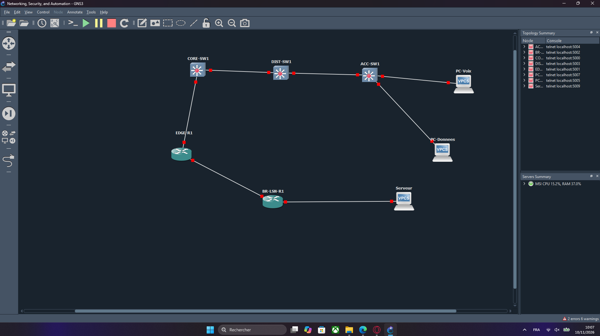
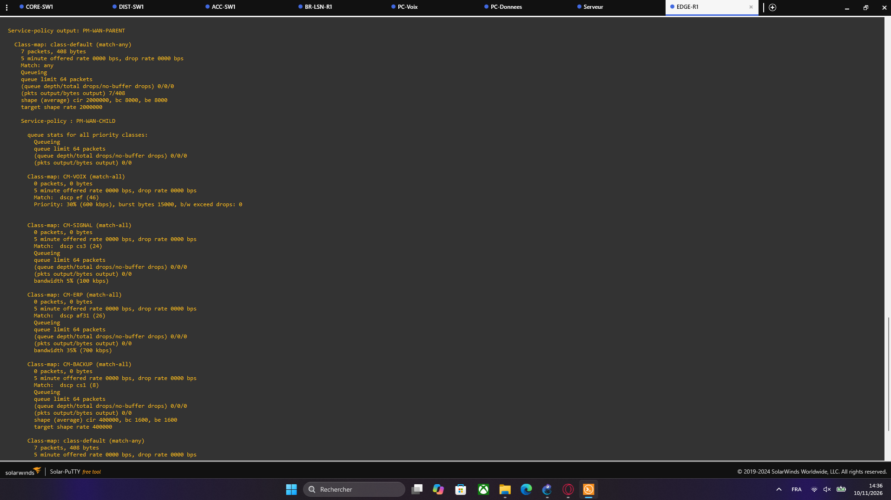
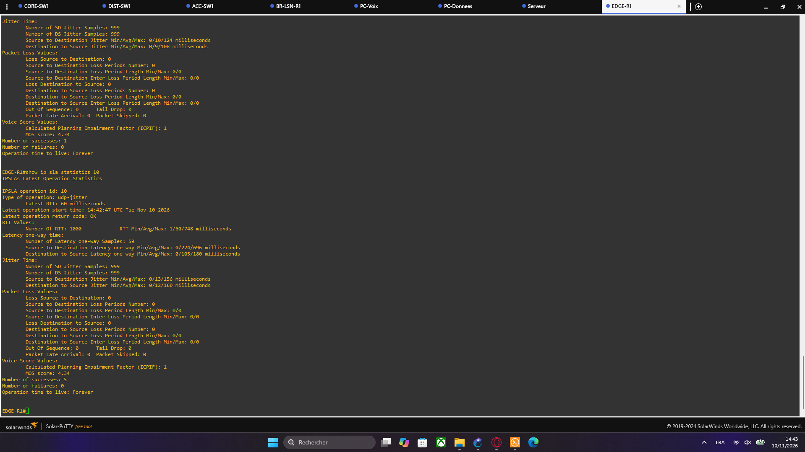
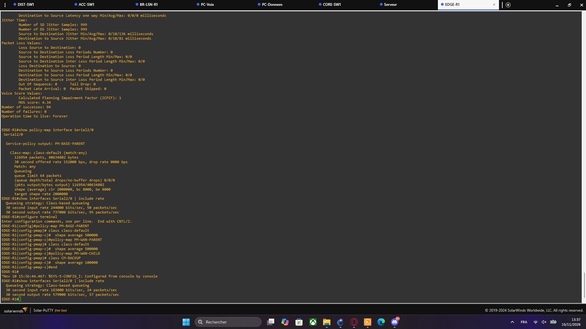
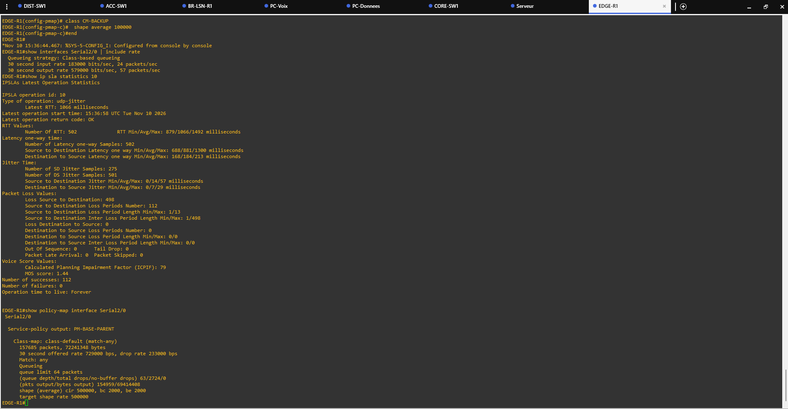
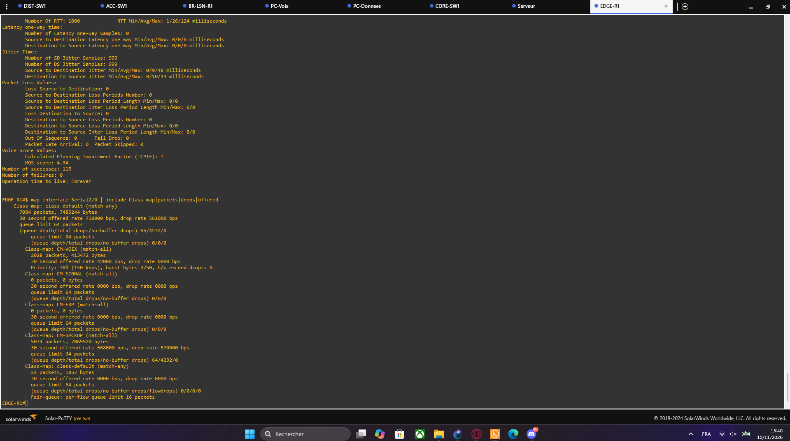

# CDC-09 — Qualité de service (QoS) sur les liaisons WAN

**Client :** NovaTrans Romandie SA · **Prestataire :** Satom IT & Learning Solutions
**Besoin couvert :** B1 — Voix et ERP protégés sur les liaisons WAN
**Plateforme :** GNS3 (routeurs c7200 IOS 15.2, commutateurs simulés par c3745 + NM-16ESW)
**Ingénieur :** Rayan Zaghez · **Date :** novembre 2026

---

## 1. Demande du client et synthèse de la solution

Depuis la mise en place de la téléphonie IP, les appels de la plateforme de tri de Genève se coupent quand les sauvegardes nocturnes saturent la liaison vers Lausanne. Le client demande de protéger la voix et l'ERP **sans acheter de bande passante**.

**Solution proposée (résumé) :**

1. **Classer** le trafic en cinq catégories (voix, signalisation, ERP, sauvegardes, reste).
2. **Marquer une seule fois, à l'entrée du réseau** (DSCP), là où l'on maîtrise l'origine du trafic.
3. **Traiter en sortie**, là où naît la congestion : file prioritaire (LLQ) pour la voix, bande passante garantie pour l'ERP, plafond de débit (shaping) pour les sauvegardes, partage équitable pour le reste.
4. **Prouver** l'effet par des mesures avant/après congestion (IP SLA et compteurs `show policy-map interface`).

---

## 2. Analyse des flux critiques

| Trafic | Source (VLAN) | DSCP | CoS | Classe | Traitement |
|---|---|---|---|---|---|
| Voix (RTP) | 40 | EF (46) | 5 | CM-VOIX | LLQ, priorité stricte (30 % du lien) |
| Signalisation voix (SIP 5060, SCCP 2000) | 40 | CS3 (24) | 3 | CM-SIGNAL | Bande passante garantie (5 %) |
| ERP / WMS | 30 | AF31 (26) | 3 | CM-ERP | Bande passante garantie (35 %) |
| Sauvegardes, partages de fichiers | 60 | CS1 (8) | 1 | CM-BACKUP | Shaping à 400 kb/s |
| Postes, navigation, reste | 20 et autres | BE (0) | 0 | class-default | `fair-queue` |

**Choix de dimensionnement.** La liaison série WAN (lien 2) est à 2 Mb/s. La voix en G.711 consomme environ 87 kb/s par appel (en-têtes inclus) : 30 % du lien (600 kb/s) couvre ainsi environ 6 appels simultanés. Les sauvegardes sont plafonnées à 400 kb/s (20 % du lien) pour laisser de la place à l'ERP.

---

## 3. Plan d'adressage (hypothèses de l'étudiant)

> Données **inventées par l'étudiant** : le sujet laisse le plan d'adressage libre.

| Réseau | Adressage |
|---|---|
| VLAN 20 — Postes | 10.10.20.0/24 |
| VLAN 30 — ERP | 10.10.30.0/24 |
| VLAN 40 — Voix | 10.10.40.0/24 |
| VLAN 60 — Sauvegardes / fichiers | 10.10.60.0/24 |
| Lien 2 EDGE-R1 ↔ BR-LSN-R1 | 10.0.2.0/30 (EDGE .1 DCE · BR .2 DTE) |
| Lien 3 EDGE-R1 ↔ CORE-SW1 | 10.0.3.0/30 (EDGE .1 · CORE .2) |
| LAN agence Lausanne | 10.20.20.0/24 |

Les passerelles des VLAN 20, 30, 40 et 60 sont les interfaces `Vlan` de CORE-SW1 (adresse `.1`). Le lien 1 (Internet) n'est pas monté dans cette maquette, car il n'est pas utile au CDC-09.

### Câblage réel de la maquette GNS3

| Lien | Équipement A | Port A | Équipement B | Port B |
|---|---|---|---|---|
| 2 (WAN série) | EDGE-R1 | `Serial2/0` (DCE) | BR-LSN-R1 | `Serial1/0` (DTE) |
| 3 | EDGE-R1 | `FastEthernet1/0` | CORE-SW1 | `FastEthernet0/0` (port natif routé) |
| 4 | CORE-SW1 | `FastEthernet1/0` | DIST-SW1 | `FastEthernet1/0` (trunk) |
| 5 | DIST-SW1 | `FastEthernet1/1` | ACC-SW1 | `FastEthernet1/0` (trunk) |
| 6 | ACC-SW1 | `FastEthernet1/1` | PC-Voix | `e0` (VLAN 40) |
| 6 | ACC-SW1 | `FastEthernet1/2` | PC-Donnees | `e0` (VLAN 60) |
| Lausanne | BR-LSN-R1 | `FastEthernet0/0` | Serveur | `e0` |

**Figure 1 — Topologie de la maquette GNS3**



**Images utilisées :** routeurs c7200 (IOS 15.2(4)S7) ; commutateurs simulés par des routeurs c3745 (IOS 12.4(4)T1) avec module NM-16ESW. Les noms de ports du schéma de référence (`Gi1/0/x`, `Se0/0/0`) sont remplacés par ceux de cette maquette.

**Limites de la maquette (à signaler au client) :**
- le NM-16ESW ne gère ni le MQC ni les ports routés : le marquage DSCP est donc fait à l'entrée d'EDGE-R1 (liaison 3), à la place de la liaison 4 du schéma ;
- les ports sont en FastEthernet (100 Mb/s) et non en GigaEthernet ;
- le débit de la liaison série n'est pas limité par GNS3 : le goulot de 2 Mb/s est créé par un shaper (voir 5.2 bis).

---

## 4. Configuration

### 4.1 Socle de connectivité (à appliquer en premier)

Ordre conseillé : VLAN et switchs, puis routeurs, puis VPCS. Vérifier ensuite : `show ip ospf neighbor` sur EDGE-R1, et `ping 10.20.20.10` depuis PC-Voix et PC-Donnees.

**EDGE-R1**

```
hostname EDGE-R1
no ip domain-lookup
!
interface FastEthernet1/0
 description Lien 3 - CORE-SW1 Fa0/0
 ip address 10.0.3.1 255.255.255.252
 no shutdown
!
interface Serial2/0
 description Lien 2 - BR-LSN-R1 Serial1/0 (DCE)
 ip address 10.0.2.1 255.255.255.252
 clock rate 2000000
 bandwidth 2000
 no shutdown
!
router ospf 1
 network 10.0.2.0 0.0.0.3 area 0
 network 10.0.3.0 0.0.0.3 area 0
```

**BR-LSN-R1**

```
hostname BR-LSN-R1
no ip domain-lookup
!
interface Serial1/0
 description Lien 2 - EDGE-R1 Serial2/0 (DTE)
 ip address 10.0.2.2 255.255.255.252
 bandwidth 2000
 no shutdown
!
interface FastEthernet0/0
 description LAN agence Lausanne - Serveur
 ip address 10.20.20.1 255.255.255.0
 no shutdown
!
router ospf 1
 network 10.0.2.0 0.0.0.3 area 0
 network 10.20.20.0 0.0.0.255 area 0
!
ip sla responder
```

**CORE-SW1**

```
! 1) En mode privilégié, AVANT "configure terminal" :
!    vlan database
!     vlan 20 name POSTES
!     vlan 30 name ERP
!     vlan 40 name VOIX
!     vlan 60 name SAUVEGARDES
!     exit
!
! 2) Puis en mode de configuration :
hostname CORE-SW1
no ip domain-lookup
ip routing
!
interface FastEthernet0/0
 description Lien 3 - EDGE-R1 Fa1/0 (port natif routé)
 ip address 10.0.3.2 255.255.255.252
 no shutdown
!
interface FastEthernet1/0
 description Lien 4 - DIST-SW1 Fa1/0 (trunk)
 switchport mode trunk
 no shutdown
!
interface Vlan20
 ip address 10.10.20.1 255.255.255.0
 no shutdown
interface Vlan30
 ip address 10.10.30.1 255.255.255.0
 no shutdown
interface Vlan40
 ip address 10.10.40.1 255.255.255.0
 no shutdown
interface Vlan60
 ip address 10.10.60.1 255.255.255.0
 no shutdown
!
router ospf 1
 network 10.0.3.0 0.0.0.3 area 0
 network 10.10.0.0 0.0.255.255 area 0
```

**DIST-SW1**

```
! 1) En mode privilégié, AVANT "configure terminal" :
!    vlan database
!     vlan 20 name POSTES
!     vlan 30 name ERP
!     vlan 40 name VOIX
!     vlan 60 name SAUVEGARDES
!     exit
!
! 2) Puis en mode de configuration :
hostname DIST-SW1
no ip domain-lookup
!
interface FastEthernet1/0
 description Lien 4 - CORE-SW1 Fa1/0 (trunk)
 switchport mode trunk
 no shutdown
!
interface FastEthernet1/1
 description Lien 5 - ACC-SW1 Fa1/0 (trunk)
 switchport mode trunk
 no shutdown
```

**ACC-SW1**

```
! 1) En mode privilégié, AVANT "configure terminal" :
!    vlan database
!     vlan 20 name POSTES
!     vlan 30 name ERP
!     vlan 40 name VOIX
!     vlan 60 name SAUVEGARDES
!     exit
!
! 2) Puis en mode de configuration :
hostname ACC-SW1
no ip domain-lookup
!
interface FastEthernet1/0
 description Lien 5 - DIST-SW1 Fa1/1 (trunk)
 switchport mode trunk
 no shutdown
!
interface FastEthernet1/1
 description Lien 6 - PC-Voix (VLAN 40)
 switchport mode access
 switchport access vlan 40
 no shutdown
!
interface FastEthernet1/2
 description Lien 6 - PC-Donnees (VLAN 60)
 switchport mode access
 switchport access vlan 60
 no shutdown
```

**VPCS**

```
# Console de PC-Voix
ip 10.10.40.10/24 10.10.40.1
save
# Console de PC-Donnees
ip 10.10.60.10/24 10.10.60.1
save
# Console de Serveur
ip 10.20.20.10/24 10.20.20.1
save
```

### 4.2 Politique QoS sur EDGE-R1

Classification, marquage à l'entrée, file prioritaire (LLQ) pour la voix, bande passante garantie pour l'ERP, plafond des sauvegardes et partage équitable pour le reste.

```
! === Classification ===
ip access-list extended ACL-SIGNAL
 permit udp 10.10.40.0 0.0.0.255 any eq 5060
 permit tcp 10.10.40.0 0.0.0.255 any eq 5060
 permit tcp 10.10.40.0 0.0.0.255 any eq 2000
ip access-list extended ACL-VOIX
 permit ip 10.10.40.0 0.0.0.255 any
ip access-list extended ACL-ERP
 permit ip 10.10.30.0 0.0.0.255 any
ip access-list extended ACL-BACKUP
 permit ip 10.10.60.0 0.0.0.255 any
!
! === Marquage a l'entree (Fa1/0, cote LAN) ===
! La signalisation est testee AVANT la voix.
class-map match-all CM-SIGNAL-IN
 match access-group name ACL-SIGNAL
class-map match-all CM-VOIX-IN
 match access-group name ACL-VOIX
class-map match-all CM-ERP-IN
 match access-group name ACL-ERP
class-map match-all CM-BACKUP-IN
 match access-group name ACL-BACKUP
!
policy-map PM-MARQUAGE-IN
 class CM-SIGNAL-IN
  set dscp cs3
 class CM-VOIX-IN
  set dscp ef
 class CM-ERP-IN
  set dscp af31
 class CM-BACKUP-IN
  set dscp cs1
!
interface FastEthernet1/0
 service-policy input PM-MARQUAGE-IN
!
! === Classes de traitement (lecture du DSCP) ===
class-map match-all CM-VOIX
 match dscp ef
class-map match-all CM-SIGNAL
 match dscp cs3
class-map match-all CM-ERP
 match dscp af31
class-map match-all CM-BACKUP
 match dscp cs1
!
! === Sortie LAN (liaison 3) : LLQ voix ===
policy-map PM-LAN-OUT
 class CM-VOIX
  priority percent 30
 class CM-SIGNAL
  bandwidth percent 5
 class CM-ERP
  bandwidth percent 30
 class class-default
  fair-queue
!
interface FastEthernet1/0
 service-policy output PM-LAN-OUT
!
! === Sortie WAN (liaison 2) : shaping 2 Mb/s + LLQ + plafond sauvegardes ===
policy-map PM-WAN-CHILD
 class CM-VOIX
  priority percent 30
 class CM-SIGNAL
  bandwidth percent 5
 class CM-ERP
  bandwidth percent 35
 class CM-BACKUP
  shape average 400000
 class class-default
  fair-queue
!
policy-map PM-WAN-PARENT
 class class-default
  shape average 2000000
  service-policy PM-WAN-CHILD
!
interface Serial2/0
 service-policy output PM-WAN-PARENT
```

> Si l'IOS refuse `shape average` dans la classe CM-BACKUP du sous-groupe, remplacer par :
> `police cir 400000 conform-action transmit exceed-action drop`

---

**Figure 2 — Politique QoS appliquée sur `Serial2/0` (`show policy-map interface Serial2/0`)**



---

## 5. Plan de tests et preuves

### 5.1 Outils de mesure

- **Voix simulée :** IP SLA `udp-jitter` depuis EDGE-R1 vers BR-LSN-R1, marqué EF (`tos 184`).

```
! EDGE-R1
ip sla 10
 udp-jitter 10.0.2.2 16384 codec g711ulaw
 tos 184
 frequency 10
ip sla schedule 10 life forever start-time now
```

- **Congestion :** `iperf3` entre un hôte de la VLAN 60 (Genève) et un hôte du LAN de Lausanne (10.20.20.10), avec un client Linux léger dans GNS3 (appliance QEMU Alpine ou Tiny Core ; VPCS ne fait pas d'iperf ; option plus simple décrite en 5.2 bis).

```
iperf3 -s                                          # côté Lausanne
iperf3 -c 10.20.20.10 -u -b 5M -l 1400 -t 120      # côté Genève, VLAN 60
```

### 5.2 Scénarios

| # | Scénario | Commandes de preuve | Capture |
|---|---|---|---|
| A | Repos (sans flood), politique de base `PM-BASE` (shaping 2 Mb/s seul, sans QoS) | `show ip sla statistics 10` | Figure 3 |
| B | Congestion (flood), politique de base `PM-BASE` | `show ip sla statistics 10` (perte, gigue, latence) | Figure 5 |
| C | Congestion (flood), politique complète `PM-WAN-PARENT` | `show ip sla statistics 10` | Figure 6 |
| D | Compteurs par classe pendant C | `show policy-map interface Serial2/0` | Figure 6 |
| E | Vérification du marquage | `show policy-map interface FastEthernet1/0 input` (ou capture Wireshark sur le lien 3) | Non réalisé (pas de capture) |

### 5.2 bis Créer le goulot d'étranglement et la congestion

Dans GNS3, le débit d'une liaison série n'est en général pas limité par `clock rate` : sans limite, il n'y a pas de congestion et le scénario B ne montrerait rien. Le goulot de 2 Mb/s est donc créé par un shaper. Le scénario « sans QoS » (A et B) utilise un shaper seul, avec une file unique :

```
! EDGE-R1 — scénarios A et B
policy-map PM-BASE-PARENT
 class class-default
  shape average 2000000
interface Serial2/0
 no service-policy output PM-WAN-PARENT
 service-policy output PM-BASE-PARENT
```

```
! EDGE-R1 — scénario C
interface Serial2/0
 no service-policy output PM-BASE-PARENT
 service-policy output PM-WAN-PARENT
```

**Générateur de congestion sans machine Linux :** un ping étendu depuis EDGE-R1, marqué CS1 (`tos 32`) pour représenter une sauvegarde.

```
EDGE-R1# ping
Protocol [ip]:
Target IP address: 10.0.2.2
Repeat count [5]: 100000
Datagram size [100]: 1400
Timeout in seconds [2]: 0
Extended commands [n]: y
Type of service [0]: 32
(Entrée pour les autres paramètres)
```

Lancer le flood, puis relever l'IP SLA (`show ip sla statistics 10`) et les compteurs (`show policy-map interface Serial2/0`) pendant que le flood tourne.

### 5.3 Résultats mesurés

**Paramètres de la maquette.** Un émulateur sur PC ne produit pas 2 Mb/s de trafic de fond (le flood de CORE-SW1 atteint environ 0,7 Mb/s). Pour créer une vraie congestion, le goulot a été ramené de 2 Mb/s à **500 kb/s**, et le plafond des sauvegardes de 400 kb/s à **100 kb/s** (même proportion de 20 %). Les pourcentages de la politique (voix 30 %, signalisation 5 %, ERP 35 %) sont inchangés. Le scénario A a été relevé avant cette réduction, avec un shaper à 2 Mb/s : seul l'écart entre A, B et C compte.

```
policy-map PM-BASE-PARENT
 class class-default
  shape average 500000
policy-map PM-WAN-PARENT
 class class-default
  shape average 500000
policy-map PM-WAN-CHILD
 class CM-BACKUP
  shape average 100000
```

**Figure 3 — Scénario A : réseau au repos, sans QoS**



**Figure 4 — Réduction du goulot à 500 kb/s (configuration appliquée sur EDGE-R1)**



**Figure 5 — Scénario B : congestion sans QoS (IP SLA, puis compteurs `PM-BASE-PARENT`)**



**Figure 6 — Scénario C : congestion avec QoS (IP SLA, puis compteurs par classe)**



**Tableau récapitulatif**

| Mesure (sonde voix IP SLA) | A — repos, sans QoS | B — congestion, sans QoS | C — congestion, avec QoS |
|---|---|---|---|
| Perte de paquets (sens aller) | 0 % | 49,8 % (498 sur 1000) | 0 % |
| RTT moyen (min / max) | 25 ms (1 / 160) | 1066 ms (879 / 1492) | 26 ms (1 / 124) |
| Gigue moyenne (aller / retour) | 10 / 9 ms | 14 / 7 ms | 9 / 10 ms |
| Qualité vocale (MOS) | 4,34 | 1,44 | 4,34 |
| Classe CM-VOIX (compteurs) | n/a | n/a | 2028 paquets, 0 perte |
| Classe CM-BACKUP (compteurs) | n/a | n/a | 5034 paquets, 4232 abandonnés, débit résiduel d'environ 98 kb/s |

### 5.4 Analyse

- **Sans QoS (B)**, la file du shaper est pleine : près de la moitié des paquets de voix sont perdus et le temps de réponse dépasse la seconde. Avec un MOS de 1,44, la communication est inaudible.
- **Avec QoS (C)**, les mêmes conditions de saturation donnent zéro perte, un RTT proche du repos et un MOS de 4,34.
- **Les compteurs expliquent le résultat.** La classe voix est servie en priorité sans aucune perte. La classe sauvegardes absorbe toute la congestion : elle offre 668 kb/s, en perd 570 kb/s et laisse passer environ 98 kb/s, ce qui correspond au plafond de 100 kb/s.
- **Limites.** Les classes ERP et signalisation n'ont pas reçu de trafic dans ces essais (compteurs à 0). Les valeurs absolues dépendent de la charge du PC qui émule le réseau.

---

## 6. Justification : « marquer à l'entrée, traiter en sortie »

- **Une seule classification, à la frontière de confiance.** Le marquage est posé une fois, là où l'origine du trafic est connue (VLAN, ports). Les équipements suivants se contentent de lire le DSCP : c'est plus simple à maintenir et moins coûteux en CPU.
- **Un utilisateur ne peut pas s'auto-prioriser.** En remarquant à l'entrée, on ignore les marquages posés par les postes.
- **La congestion se produit en sortie.** C'est à la sortie d'une interface (ici la série à 2 Mb/s) que les paquets attendent. C'est donc là que les files LLQ et le shaping ont un effet.
- **Cohérence de bout en bout.** Le même plan de marquage est lu par EDGE-R1 et BR-LSN-R1, ce qui évite les politiques contradictoires.

---

## 7. Fiche de synthèse pour le client (1 page)

**Problème.** Les sauvegardes de nuit remplissent la liaison Genève–Lausanne et coupent les appels.

**Ce que nous avons fait.** Nous avons donné une priorité absolue à la voix, garanti de la place à l'ERP et plafonné les sauvegardes à environ un cinquième de la liaison. Aucun achat de bande passante n'est nécessaire.

**Résultat.** Quand la liaison est saturée, sans protection la voix perd environ la moitié de ses paquets (qualité mesurée 1,44 sur 5, inutilisable). Avec la nouvelle politique, elle ne perd plus rien et sa qualité reste à 4,34 sur 5, tandis que les sauvegardes sont ralenties. Les mesures ont été faites sur une maquette réduite (voir 5.3).

**Recommandations.**
1. Conserver les sauvegardes sur la plage nocturne et surveiller le plafond de 400 kb/s ; l'augmenter si la fenêtre de sauvegarde devient trop courte.
2. Réévaluer les pourcentages si le nombre d'appels simultanés dépasse 6.
3. Ajouter le marquage aux nouveaux VLAN (+40 postes prévus) dès leur création.
4. Documenter tout changement de politique dans la documentation réseau.

---

## 8. Livrables joints

- [ ] Schéma de la maquette (PNG)
- [ ] Fichiers de configuration `.txt` : EDGE-R1, BR-LSN-R1, CORE-SW1
- [x] Captures des scénarios A, B, C et D (figures 3 à 6)
- [ ] Capture E (vérification du marquage) : `show policy-map interface FastEthernet1/0 input` sur EDGE-R1
- [ ] Tableau de résultats 5.3 complété

---

## 9. Usage de l'IA générative

Claude (Anthropic) a été utilisé pour établir la trame du rapport et un premier jet des configurations. Les configurations ont été saisies, vérifiées et adaptées par l'étudiant sur la maquette GNS3, et les mesures proviennent de ses propres essais.
