# CDC-10 — Supervision, découverte et maintenance du réseau

**Client :** NovaTrans Romandie SA · **Prestataire :** Satom IT & Learning Solutions
**Plateforme :** GNS3 (routeurs c7200 IOS 15.2, commutateurs simulés par c3745 + NM-16ESW) et une machine virtuelle Ubuntu 16.04 (NMS-01)
**Ingénieur :** Rayan Zaghez · **Date :** 12 novembre 2026

> Les mots de passe SNMPv3 et d'administration du labo sont masqués par `********` dans les fichiers de configuration et dans les captures.

---

## 1. Demande du client et synthèse de la solution

Le client veut **voir** son réseau avant que les utilisateurs ne l'appellent : savoir si un équipement ou une liaison critique est tombé, si la liaison WAN est saturée, et pouvoir retrouver une configuration perdue.

**Solution proposée :** un poste de supervision unique, **NMS-01**, placé dans un VLAN de gestion dédié (VLAN 99), qui :

1. **interroge** les 5 équipements en **SNMPv3 authentifié et chiffré** (état, débits, erreurs, uptime) ;
2. **affiche** ces mesures dans un tableau de bord Grafana, filtrable par équipement ;
3. **prévient** par des alertes Prometheus (équipement injoignable, liaison critique coupée, liaison WAN saturée) ;
4. **centralise les journaux** (Syslog) et **garde l'heure commune** (NTP) pour que les événements soient comparables ;
5. **découvre** les voisins (CDP) et **sauvegarde** les configurations (TFTP).

| Besoin | Brique | Où |
|---|---|---|
| Mesurer | SNMPv3 (SHA / AES-128) + `snmp_exporter` + Prometheus | NMS-01 et équipements |
| Visualiser | Grafana | NMS-01 |
| Alerter | Règles d'alerte Prometheus | NMS-01 |
| Journaliser | Syslog (UDP/514, niveau informational) | équipements → NMS-01 |
| Dater | NTP (EDGE-R1 en référence, strate 2) | équipements |
| Découvrir | CDP (LLDP indisponible, voir §6) | équipements |
| Sauvegarder | TFTP (UDP/69) | équipements → NMS-01 |

---

## 2. Plan d'adressage et câblage ajoutés

Le plan du CDC-09 est conservé. S'ajoutent :

| Élément | Adressage |
|---|---|
| VLAN 99 — GESTION | 10.10.99.0/24 |
| CORE-SW1 (passerelle du VLAN 99) | 10.10.99.1 |
| DIST-SW1 | 10.10.99.2 |
| ACC-SW1 | 10.10.99.3 |
| **NMS-01** (VM Ubuntu) | **10.10.99.10** |

| Lien | Équipement A | Port A | Équipement B | Port B |
|---|---|---|---|---|
| Supervision | CORE-SW1 | `FastEthernet1/4` (accès VLAN 99) | Cloud GNS3 (VMnet1) | carte hôte VMnet1 → `ens37` de NMS-01 |

La VM a deux cartes : `ens33` (NAT, accès Internet pour installer les paquets) et `ens37` (10.10.99.10/24, réseau de gestion). Une route `10.0.0.0/8 via 10.10.99.1` lui permet d'atteindre EDGE-R1 et BR-LSN-R1. Les équipements sont interrogés par leur adresse : EDGE-R1 `10.0.3.1`, BR-LSN-R1 `10.0.2.2`, CORE-SW1 `10.10.99.1`, DIST-SW1 `10.10.99.2`, ACC-SW1 `10.10.99.3`.

**Figure 1 — Topologie de la maquette GNS3** (le nuage `Cloud1` représente le réseau VMnet1 auquel est branchée la VM NMS-01, qui n'est pas un nœud GNS3)

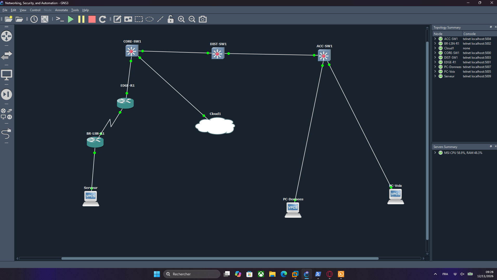

**Figure 2 — NMS-01 joint les équipements depuis 10.10.99.10** (EDGE-R1 en `10.0.3.1`, BR-LSN-R1 en `10.0.2.2`, passerelle `10.10.99.1`)

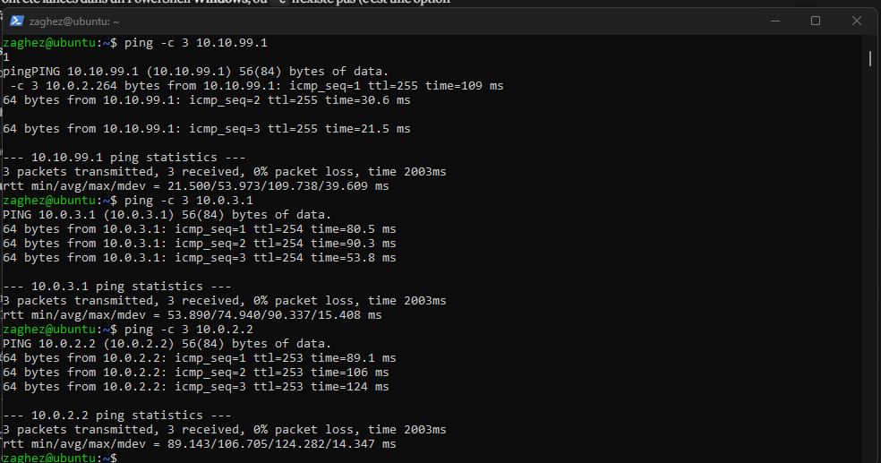

---

## 3. Configuration

Fichiers fournis dans `configs/` (secrets masqués) :

| Fichier | Contenu |
|---|---|
| `EDGE-R1_03_supervision.txt`, `BR-LSN-R1_03_supervision.txt` | SNMPv3, Syslog, NTP |
| `CORE-SW1_03_supervision.txt`, `DIST-SW1_03_supervision.txt`, `ACC-SW1_03_supervision.txt` | VLAN 99, SNMPv3, Syslog, NTP |
| `NMS-01/` | réseau, rsyslog, TFTP, auth `snmp_exporter`, `prometheus.yml`, `alerts.yml`, source de données Grafana, services |
| `../grafana/NovaTrans-supervision_export-Grafana.json` | export du tableau de bord |

### 3.1 SNMPv3 (identique sur les 5 équipements)

```
ip access-list standard ACL-SNMP-NMS
 permit 10.10.99.10
!
snmp-server view V-READ iso included
snmp-server group G-NMS v3 priv read V-READ access ACL-SNMP-NMS
snmp-server user nms-user G-NMS v3 auth sha ******** priv aes 128 ********
snmp-server location Geneve
snmp-server enable traps snmp linkdown linkup
snmp-server host 10.10.99.10 version 3 priv nms-user
```

**Pourquoi ce choix :** SNMPv3 `priv` authentifie l'interrogateur (SHA) **et** chiffre les échanges (AES-128) ; la v2c enverrait sa « communauté » en clair. Le groupe n'a qu'un droit de **lecture** (`V-READ`) et seule l'adresse du NMS est acceptée (`ACL-SNMP-NMS`) : même avec le mot de passe, un autre poste ne peut pas interroger l'équipement.

### 3.2 Syslog et NTP

```
service timestamps log datetime msec
logging on
logging host 10.10.99.10
logging trap informational
!
! EDGE-R1 : référence de temps du réseau
ntp master 2
! Autres équipements
ntp server 10.0.3.1
```

NMS-01 reçoit les messages avec `rsyslog` (UDP/514) et écrit **un fichier par équipement** dans `/var/log/remote/<adresse>.log`. Les horodatages précis (`msec`) et une heure commune permettent de reconstituer la chronologie d'un incident entre plusieurs équipements.

### 3.3 Découverte (CDP) et sauvegarde (TFTP)

CDP est actif par défaut sur ces équipements. Les sauvegardes se font vers NMS-01 :

```
copy running-config tftp://10.10.99.10/EDGE-R1-confg
```

Le serveur `tftpd-hpa` n'accepte que des fichiers dans `/srv/tftp` (`--secure`) et crée les nouveaux (`--create`).

### 3.4 Collecte, tableau de bord et alertes (NMS-01)

- **snmp_exporter** (module `if_mib`, authentification `nova_v3`) traduit SNMPv3 en mesures ; **Prometheus** les collecte toutes les 15 s sur les 5 équipements ; **Grafana** les affiche.
- Trois règles d'alerte (`alerts.yml`) :

| Alerte | Condition | Durée | Gravité |
|---|---|---|---|
| `EquipementInjoignable` | `up{job="snmp"} == 0` | 1 min | critique |
| `InterfaceCritiqueDown` | `ifOperStatus == 2` sur BR-LSN-R1 `Fa0/0` ou EDGE-R1 `Serial2/0` | 30 s | critique |
| `LiaisonWANSaturee` | débit sortant `Serial2/0` d'EDGE-R1 > 30 kbit/s (seuil du labo, voir §6) | 30 s | avertissement |

- Le tableau de bord (`NovaTrans - Supervision réseau`) contient 7 panneaux : équipements joignables, uptime, état des 12 liaisons de la maquette, trafic entrant, trafic sortant, erreurs, paquets abandonnés. Une liste **Équipement** filtre l'ensemble.

---

## 4. Plan de vérification

| # | Test | Résultat attendu |
|---|---|---|
| 5.1 | NMS-01 joint les équipements | ping réussi |
| 5.2 | `snmpwalk` SNMPv3 sur les 5 équipements | nom, lieu, description renvoyés |
| 5.3 | Syslog et sauvegardes | messages reçus ; 5 fichiers `*-confg` |
| 5.4 | `show snmp user`, CDP | utilisateur SHA/AES128 ; voisins découverts |
| 5.5 | NTP | EDGE-R1 synchronisé ; les autres pointent vers lui |
| 5.6 | Prometheus : cibles | 5/5 `UP` |
| 5.7 | Alertes (3 scénarios) | `Pending` → `Firing` → retour au vert |
| 5.8 | Tableau de bord | 5 équipements, 12 liaisons, trafic visible, filtre par équipement |

---

## 5. Résultats et captures

### 5.1 Joignabilité
Voir la figure 2 : NMS-01 atteint `10.10.99.1`, `10.0.3.1` et `10.0.2.2`.

### 5.2 SNMPv3 sur les 5 équipements

**Figure 3 — `snmpwalk` SNMPv3 (authPriv, SHA/AES) sur EDGE-R1** : la description IOS 15.2(4)S7, le nom `EDGE-R1` et le lieu `Geneve` sont renvoyés.

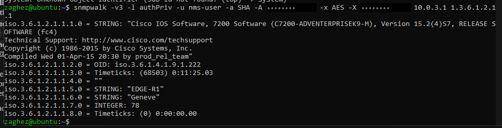

**Figure 4 — Boucle sur les 4 autres équipements** : `BR-LSN-R1`, `CORE-SW1`, `DIST-SW1`, `ACC-SW1` répondent avec leur nom.

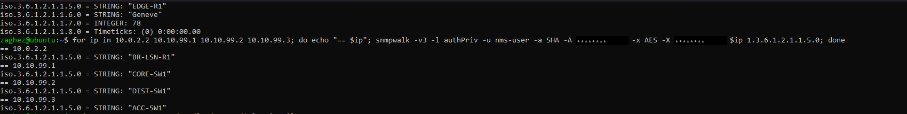

### 5.3 Syslog centralisé et sauvegardes TFTP

**Figure 5 — Journaux reçus sur NMS-01 et fichiers de sauvegarde.** Les événements `%LINK-3-UPDOWN` et `%SYS-5-CONFIG_I` arrivent dans `/var/log/remote/` ; `/srv/tftp` contient les 5 configurations.

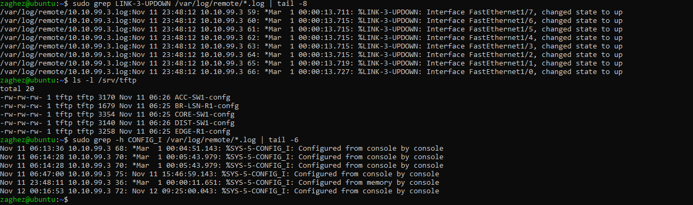

> Les horodatages commençant par `*Mar 1` sont ceux d'équipements dont l'horloge n'était pas encore réglée : c'est précisément le problème que NTP résout.

### 5.4 Utilisateur SNMPv3 et découverte CDP

**Figure 6 — `show snmp user` et `show cdp neighbors detail` sur EDGE-R1.** L'utilisateur `nms-user` utilise SHA et AES128, groupe `G-NMS`. CDP découvre CORE-SW1 (`10.0.3.2`, Cisco 3745) sur `FastEthernet1/0` et BR-LSN-R1. CDP signale aussi `Duplex: half (Mismatch)` : un **écart de duplex réel** entre EDGE-R1 `Fa1/0` et CORE-SW1 `Fa0/0`, que la découverte a mis en évidence. Il a été corrigé par `duplex full` côté CORE-SW1 (voir `configs/CORE-SW1_03_supervision.txt`).

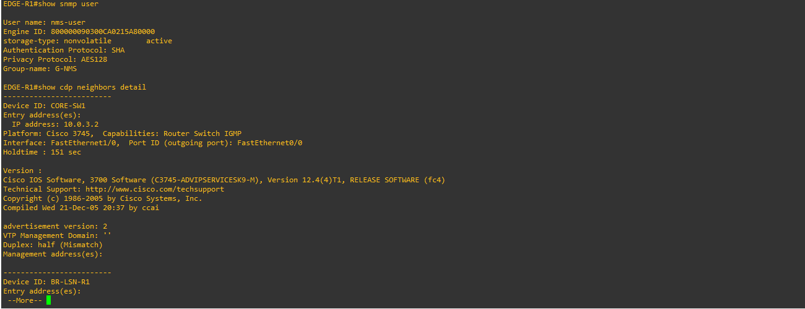

### 5.5 NTP

**Figure 7 — EDGE-R1 : `Clock is synchronized, stratum 2`** (référence locale, `ntp master 2`).

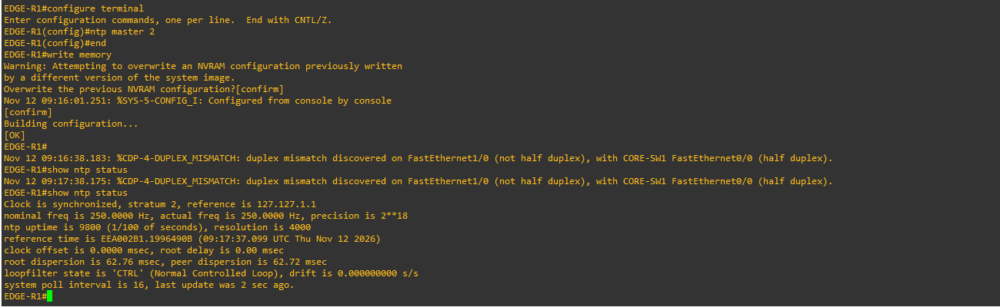

**Figure 8 — CORE-SW1 : association établie avec `10.0.3.1`** (stratum 2, `reach 377`), mais horloge encore `unsynchronized` au moment de la capture : limite de l'émulation (§6).

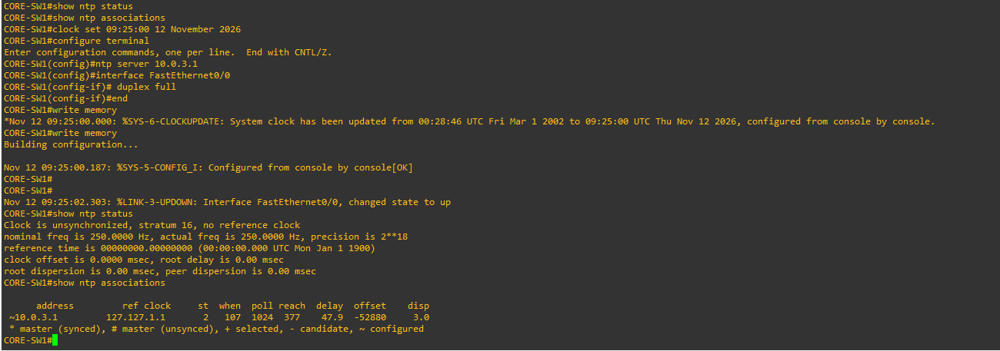

### 5.6 Cibles Prometheus

**Figure 9 — `snmp (5/5 up)`** : les 5 équipements sont collectés avec succès.

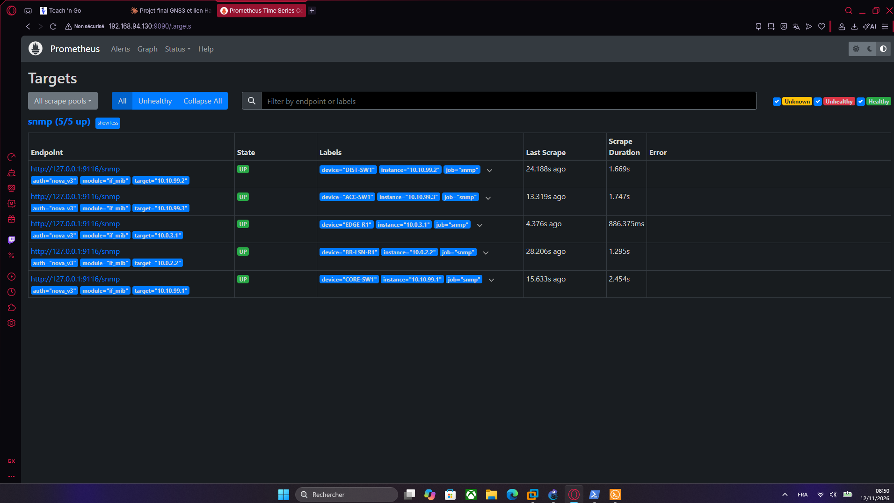

### 5.7 Alertes — trois scénarios

**Scénario 1 — liaison critique coupée (`InterfaceCritiqueDown`).** `shutdown` volontaire de `FastEthernet0/0` sur BR-LSN-R1 (le réseau de l'agence de Lausanne).

Figure 10 — alerte déclenchée (`FIRING`, `device=BR-LSN-R1`, `ifDescr=FastEthernet0/0`, valeur 2 = *down*) :

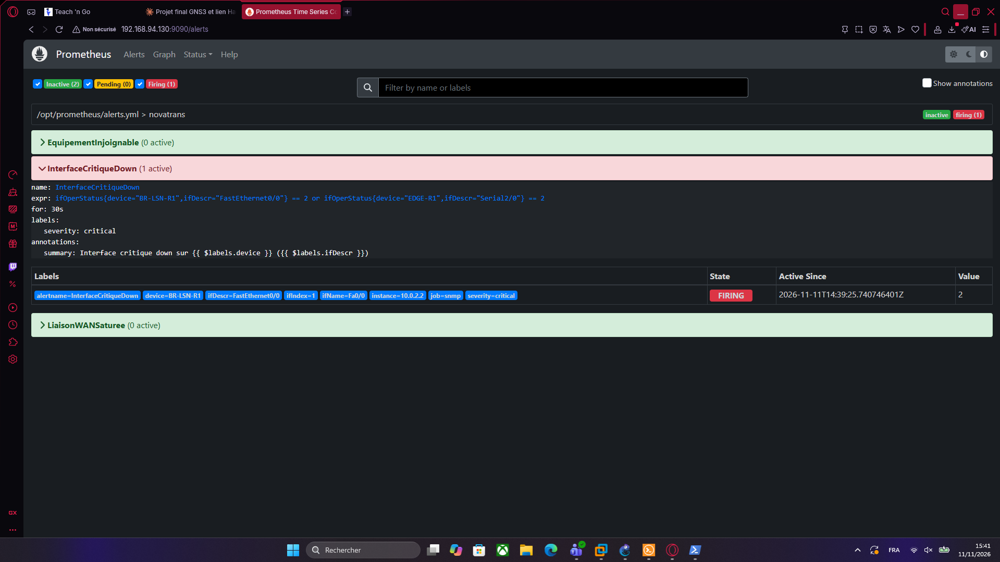

Figure 11 — après `no shutdown` : retour au vert (0 actif) :

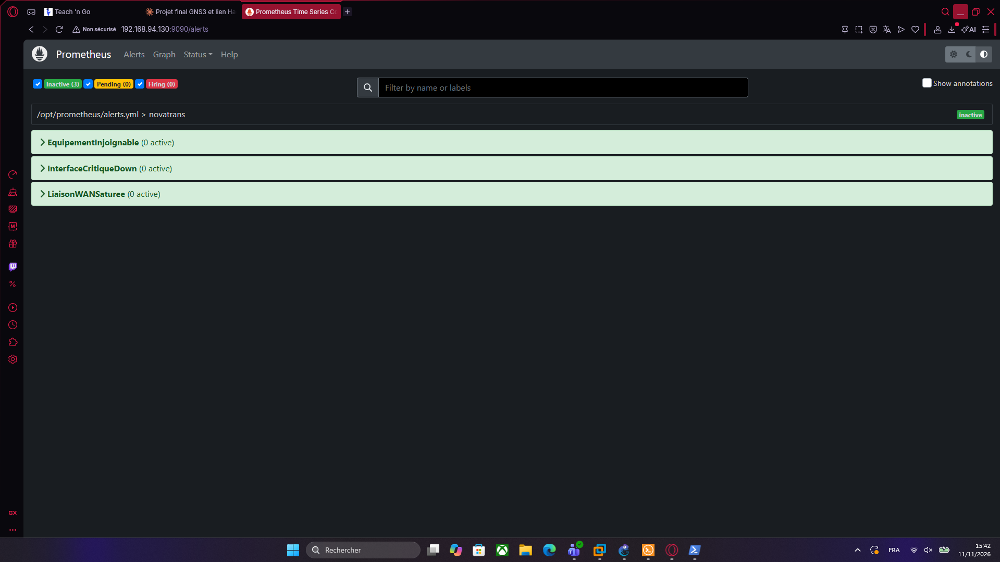

**Scénario 2 — équipement injoignable (`EquipementInjoignable`).** ACC-SW1 est rendu volontairement injoignable. L'alerte passe par `PENDING` pendant la minute d'attente, puis `FIRING`.

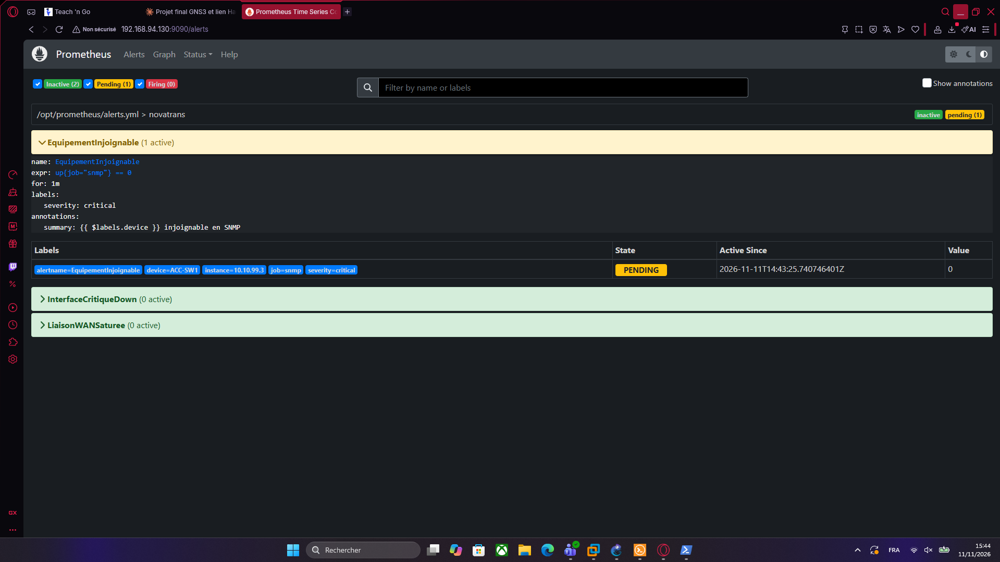

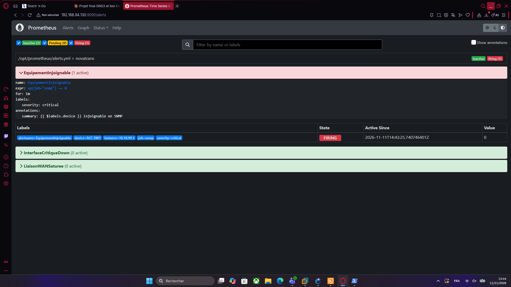

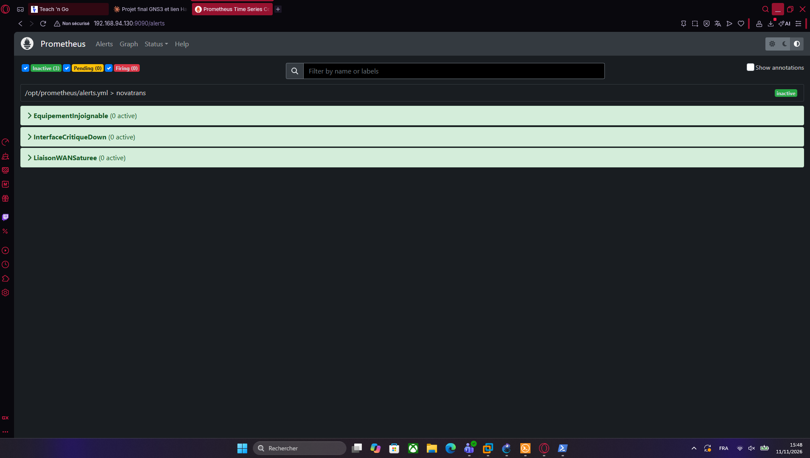

**Scénario 3 — liaison WAN saturée (`LiaisonWANSaturee`).** Un trafic de test (ping de 1 400 octets depuis CORE-SW1 vers le serveur de Lausanne `10.20.20.10`) traverse la liaison WAN. On mesure d'abord le débit réel, puis l'alerte réagit.

Figure 15 — requête PromQL `rate(ifOutOctets{...Serial2/0}[1m]) * 8` : environ **61 kbit/s** mesurés :

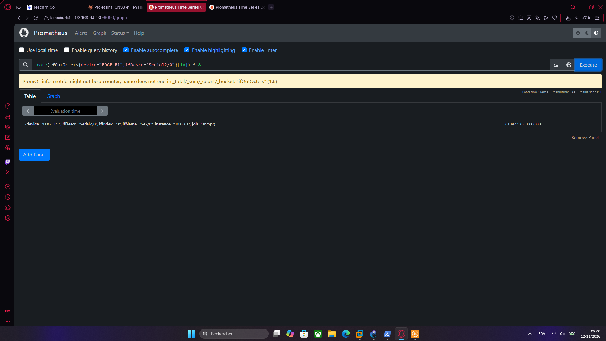

Figure 16 — `PENDING` (seuil dépassé, attente de 30 s), puis figure 17 — `FIRING` (valeur ≈ 51 kbit/s) :

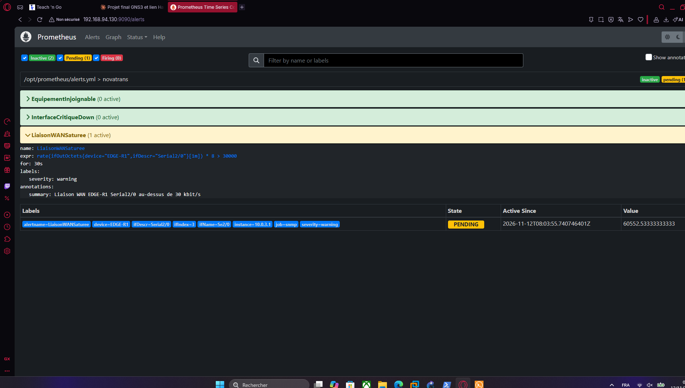

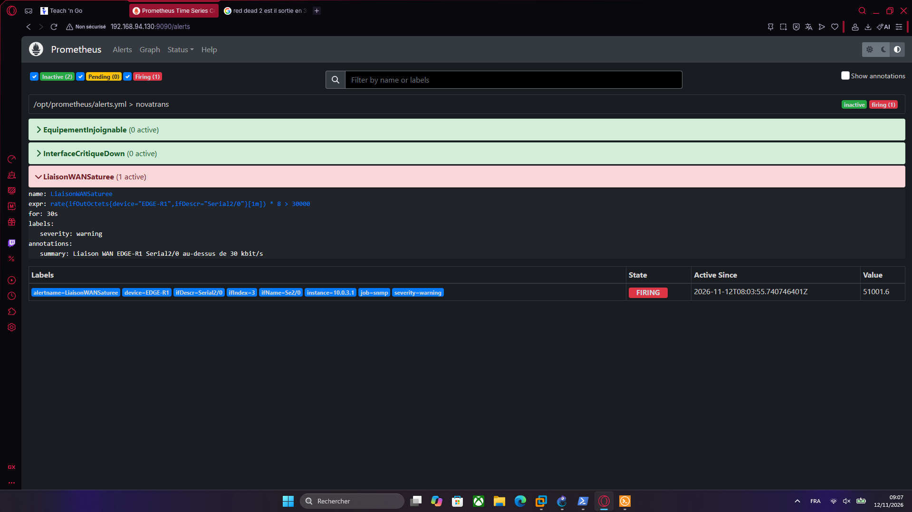

Figure 18 — trafic arrêté : l'alerte repasse au vert (`Inactive (3)`, `Firing (0)`) :

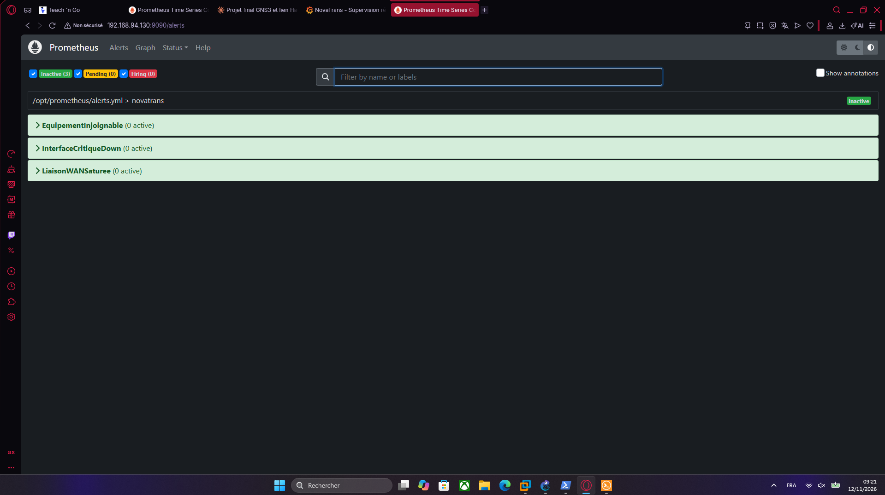

**Observation importante (effet de bord).** Lors d'un premier essai avec un trafic beaucoup trop agressif, les interrogations SNMP ont échoué à leur tour et `EquipementInjoignable` s'est déclenchée sur EDGE-R1 et BR-LSN-R1, alors que ces équipements fonctionnaient. Le trafic de supervision partage les liaisons avec le trafic utilisateur : en cas de saturation, **on perd la visibilité au moment où on en a le plus besoin**. Voir les recommandations au §6.

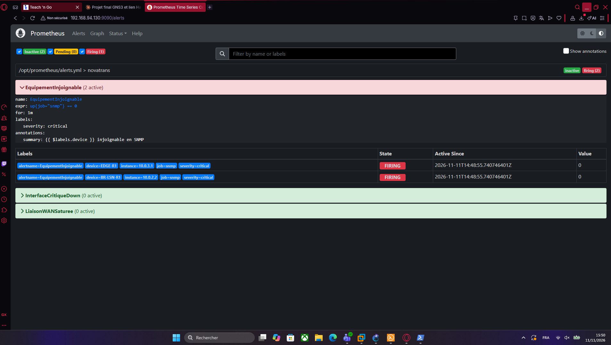

### 5.8 Tableau de bord Grafana

**Figure 19 — vue d'ensemble** : 5 équipements `UP`, uptimes, 12 liaisons `UP`, et la bosse de trafic (≈ 70 kbit/s) du scénario 3 en entrée et en sortie.

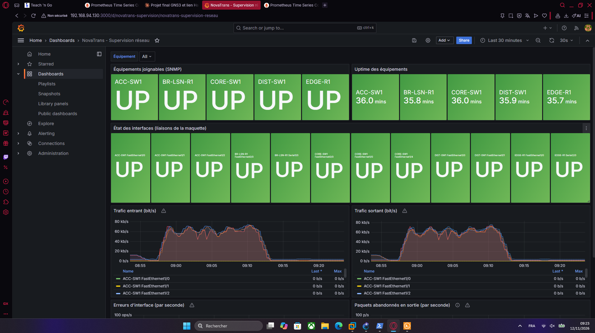

**Figure 20 — filtre par équipement** (liste *Équipement* sur `EDGE-R1`) : seuls EDGE-R1 et ses deux liaisons (`FastEthernet1/0`, `Serial2/0`) sont affichés ; 0 erreur, 0 paquet abandonné.

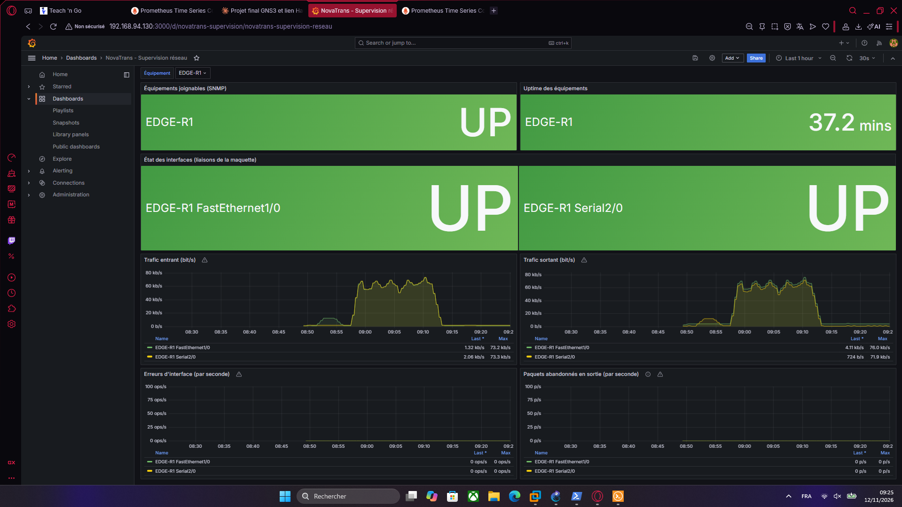

Le tableau de bord est exporté dans `grafana/NovaTrans-supervision_export-Grafana.json` (importable via *Dashboards → Import*).

---

## 6. Limites de la maquette et recommandations

| Sujet | Constat dans le labo | Recommandation pour la production |
|---|---|---|
| **LLDP** | `lldp run` est refusé par ces images IOS. La découverte utilise **CDP**, propriétaire Cisco. | Activer LLDP sur du matériel qui le gère, pour découvrir aussi les équipements non-Cisco. |
| **NTP des commutateurs** | EDGE-R1 est synchronisé. Sur CORE-SW1 l'association est établie (`reach 377`) mais l'horloge reste `unsynchronized` : l'intervalle de sondage est de 1 024 s et l'IOS émulé met longtemps à se caler. Les autres équipements sont configurés de la même façon ; leur synchronisation n'a pas été contrôlée. | Deux sources NTP fiables (au moins) ; contrôler `show ntp status` après mise en service. |
| **Seuil d'alerte WAN** | Dans la maquette, la liaison est bridée à 500 kb/s (essais du CDC-09) : le seuil est fixé à **30 kbit/s** pour pouvoir le déclencher avec un trafic de test. | En production, alerter à **80 % de la capacité** : 1,6 Mb/s sur la liaison de 2 Mb/s. |
| **Supervision « dans la bande »** | Le trafic de supervision emprunte les liaisons de données (effet de bord constaté au §5.7). | Réserver une classe QoS au SNMP/Syslog (voir CDC-09) ou prévoir un réseau de gestion séparé. |
| **Syslog et TFTP** | Syslog en UDP (perte possible) ; TFTP sans authentification ni chiffrement ; sauvegardes lancées à la main. | Syslog fiable (TCP/TLS), SCP/SFTP, sauvegardes planifiées (voir CDC-14, automatisation). |
| **Secrets** | Mots de passe saisis en ligne de commande pour les tests. | Gestionnaire de secrets, fichiers protégés, rotation. |
| **Horloges** | Certains journaux portent une date de démarrage (`*Mar 1`) tant que NTP n'a pas réglé l'équipement. | Régler l'heure avant d'activer la journalisation. |
| **Duplex** | Écart de duplex relevé par CDP entre EDGE-R1 et CORE-SW1, corrigé côté CORE-SW1. | Imposer la même configuration (auto/auto ou fixe) des deux côtés. |
| **Sauvegardes** | Les copies TFTP datent d'avant la configuration NTP. | Relancer la sauvegarde après chaque changement validé. |

---

## 7. Résumé pour le client (une page)

**NovaTrans Romandie SA — Supervision du réseau : ce qui est en place**

**En deux mots.** Votre réseau est maintenant surveillé en continu par un poste unique. Vous voyez en un coup d'œil si vos équipements et vos liaisons principales fonctionnent, et vous êtes prévenu avant que vos équipes ne le remarquent.

**Ce que vous pouvez faire dès maintenant**
- Ouvrir le **tableau de bord** : les 5 équipements (Genève et Lausanne) apparaissent en vert quand tout va bien. On peut afficher un seul équipement.
- Suivre le **trafic** des liaisons, y compris la liaison entre Genève et Lausanne, et repérer les erreurs ou les pertes.
- Retrouver l'**historique des événements** de chaque équipement (journaux centralisés) et leur **configuration sauvegardée**.

**Les alertes mises en place**
1. **Équipement injoignable** pendant plus d'une minute.
2. **Liaison critique coupée** (réseau de l'agence de Lausanne, liaison Genève–Lausanne).
3. **Liaison Genève–Lausanne saturée.**

Nous avons testé chacune : l'alerte se déclenche, puis disparaît quand le problème est réglé.

**Ce qui est sécurisé.** Les mesures sont demandées avec un compte dédié, **chiffré et authentifié**, en lecture seule, depuis un seul poste autorisé. Un autre poste ne peut pas interroger vos équipements.

**Un point d'attention.** La surveillance utilise les mêmes liaisons que votre activité. Si une liaison est complètement saturée, les mesures peuvent elles aussi être perturbées : nous recommandons de lui réserver de la place (voir notre étude sur la qualité de service).

**À prévoir pour passer en production**
- Régler les seuils d'alerte sur votre trafic réel (80 % de la capacité de la liaison Genève–Lausanne).
- Mettre en place une synchronisation d'heure sur au moins deux sources et vérifier que tous les équipements l'utilisent.
- Planifier les sauvegardes de configuration (automatiquement) et les protéger.
- Définir qui reçoit les alertes (courriel ou messagerie) et à quelle heure on agit.

---

## 8. Déclaration d'utilisation de l'IA générative

- **Outil utilisé :** Claude (Anthropic), assistant d'IA générative.
- **Usage :** accompagnement pas à pas de la réalisation (installation de la VM, services de supervision, configuration SNMPv3/Syslog/NTP/CDP/TFTP, règles d'alerte), génération du fichier JSON du tableau de bord Grafana, aide au diagnostic des erreurs (commandes refusées, OID, NTP, effet de bord du trafic de test) et **rédaction de ce rapport**, y compris la mise en forme des configurations.
- **Travail de l'étudiant :** l'étudiant a exécuté toutes les commandes dans GNS3 et sur la VM, provoqué les pannes de test, réalisé les captures d'écran et relevé les résultats. Les captures sont les siennes ; les mots de passe y sont masqués.
- **Vérification :** les résultats présentés sont ceux observés dans la maquette. Les points qui n'ont pas pu être vérifiés (synchronisation NTP des commutateurs) sont signalés comme tels au §6.
- **Limite connue :** les fichiers de configuration de `DIST-SW1`, `ACC-SW1` et de la VM ont été reconstitués à partir du modèle appliqué ; ils doivent être relus contre `show running-config` et les fichiers réels avant tout usage.
