# CDC-11 — Conception hiérarchique et migration du site de Genève

**Client :** NovaTrans Romandie SA · **Prestataire :** Satom IT & Learning Solutions
**Besoin couvert :** extension du site de Genève (+40 postes, +12 bornes Wi-Fi) sans point unique de défaillance
**Plateforme :** GNS3 (routeurs c7200 IOS 15.2, commutateurs simulés par c3745 + NM-16ESW, IOS 12.4)
**Ingénieur :** Rayan Zaghez · **Date :** 12 novembre 2026

---

## 1. Demande du client et synthèse de la solution

Le site de Genève doit accueillir 40 postes et 12 bornes Wi-Fi de plus. Aujourd'hui, une panne d'un équipement de cœur ou de distribution isole le site. Le client demande un réseau qui continue de fonctionner si un lien ou un commutateur tombe, et un dimensionnement qui tienne la croissance.

**Solution proposée (résumé) :**

1. **Trois couches** : accès (postes, téléphones, bornes), distribution (agrégation des VLAN), cœur (routage, sortie WAN). Chaque couche a un rôle et se rattache à la couche supérieure par au moins deux chemins.
2. **Cœur doublé** : CORE-SW1 et CORE-SW2, reliés par un agrégat EtherChannel (Po1) et chacun raccordé au routeur de bordure EDGE-R1.
3. **Agrégats EtherChannel** entre les deux cœurs (Po1) et entre distribution et accès (Po2).
4. **Passerelles virtuelles HSRP** (VLAN 20, 30, 40, 60, adresse virtuelle `.1`, inchangée pour les postes), avec bascule automatique et suivi du lien WAN.
5. **STP cohérent** : CORE-SW1 est la racine (4096), CORE-SW2 la racine de secours (8192), DIST-SW1 vient ensuite (16384). La racine STP est aussi le routeur HSRP actif, donc le trafic ne fait pas de détour.
6. **Preuves** : coupure de liens, relevé de la bascule HSRP et OSPF, mesure de perte de paquets.

---

## 2. Schéma de conception (3 couches)

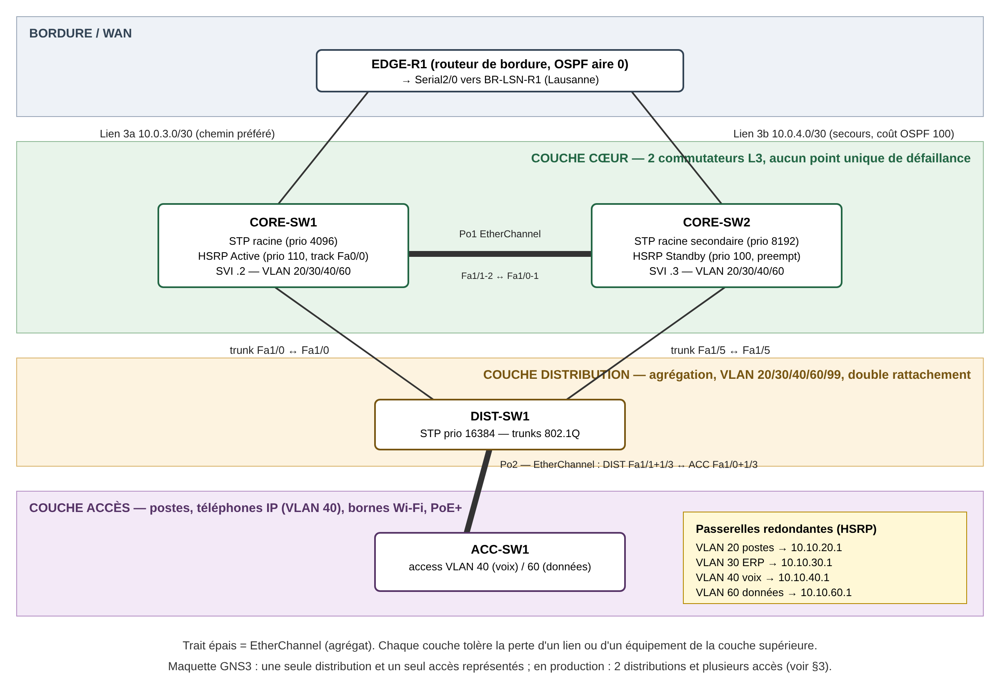

**Rôle de chaque couche :**

| Couche | Équipements | Rôle | Redondance |
|---|---|---|---|
| Accès | ACC-SW1 | Raccorder postes, téléphones IP (PoE), bornes Wi-Fi (PoE+). Marquage et VLAN. | Po2 : 2 liens vers la distribution |
| Distribution | DIST-SW1 | Agréger les accès, porter les VLAN, limiter la taille des domaines STP. | 2 trunks vers 2 cœurs différents (Fa1/0 → CORE-SW1, Fa1/5 → CORE-SW2) |
| Cœur | CORE-SW1, CORE-SW2 | Routage inter-VLAN (SVI), passerelles HSRP, OSPF, sortie vers EDGE-R1. | Po1 entre les cœurs, 2 liens vers EDGE-R1 (3a et 3b) |

### 2.1 Plan d'adressage et câblage

| Lien | Extrémité A | Extrémité B | Réseau | Remarque |
|---|---|---|---|---|
| 3a | EDGE-R1 Fa1/0 | CORE-SW1 Fa0/0 | 10.0.3.0/30 (.1 / .2) | chemin préféré (coût OSPF par défaut) |
| 3b (nouveau) | EDGE-R1 Fa0/0 | CORE-SW2 Fa0/0 | 10.0.4.0/30 (.1 / .2) | chemin de secours, `ip ospf cost 100` |
| Po1 | CORE-SW1 Fa1/1, Fa1/2 | CORE-SW2 Fa1/0, Fa1/1 | trunk 802.1Q | EtherChannel, 2 liens |
| Trunk D1 | DIST-SW1 Fa1/0 | CORE-SW1 Fa1/0 | trunk 802.1Q | |
| Trunk D2 (nouveau) | DIST-SW1 Fa1/5 | CORE-SW2 Fa1/5 | trunk 802.1Q | rattachement redondant |
| Po2 | DIST-SW1 Fa1/1, Fa1/3 | ACC-SW1 Fa1/0, Fa1/3 | trunk 802.1Q | EtherChannel, 2 liens |

| VLAN | Usage | Réseau | IP virtuelle HSRP | CORE-SW1 (réel) | CORE-SW2 (réel) |
|---|---|---|---|---|---|
| 20 | Postes | 10.10.20.0/24 | 10.10.20.1 | .2 | .3 |
| 30 | ERP | 10.10.30.0/24 | 10.10.30.1 | .2 | .3 |
| 40 | Voix | 10.10.40.0/24 | 10.10.40.1 | .2 | .3 |
| 60 | Données | 10.10.60.0/24 | 10.10.60.1 | .2 | .3 |
| 99 | Gestion | 10.10.99.0/24 | — | CORE-SW1 .1 | — |

Les postes gardent `10.10.X.1` comme passerelle : l'adresse virtuelle HSRP reprend l'ancienne adresse de CORE-SW1. Aucune reconfiguration côté poste.

---

## 3. Plan de capacité

> Les effectifs ci-dessous sont des **hypothèses de l'étudiant** : le sujet ne donne que la croissance (+40 postes, +12 bornes). Elles sont à remplacer par l'inventaire réel du client.

### 3.1 Hypothèses

| Élément | Existant | Ajout | Total |
|---|---|---|---|
| Postes de travail | 80 | +40 | 120 |
| Téléphones IP (le poste est branché derrière le téléphone) | 80 | +40 | 120 |
| Bornes Wi-Fi 6 | 0 | +12 | 12 |
| Imprimantes, divers | 8 | 0 | 8 |

Chaque poste et son téléphone partagent un seul port d'accès (téléphone en passage). Ports d'accès utilisés : 120 + 12 + 8 = **140**.

### 3.2 Ports

140 ports utilisés, plus 25 % de marge = 175 ports, soit **4 commutateurs d'accès de 48 ports (192 ports)**, environ 35 ports utilisés par commutateur. Il reste 52 ports libres sur les 4 commutateurs pour la croissance.

### 3.3 Budget PoE

Allocation par classe 802.3 (valeur réservée par le commutateur, pas la consommation mesurée) :

| Équipement | Nombre | Classe | Puissance allouée | Total |
|---|---|---|---|---|
| Téléphone IP | 120 | 802.3af classe 2 | 7 W | 840 W |
| Borne Wi-Fi 6 | 12 | 802.3at (PoE+) classe 4 | 30 W | 360 W |
| **Total site** | | | | **1 200 W** |

Avec 20 % de marge : **1 440 W**. Réparti sur 4 commutateurs (30 téléphones et 3 bornes chacun) : 30 × 7 + 3 × 30 = **300 W par commutateur** (360 W avec la marge). Un commutateur 48 ports PoE+ à 740 W couvre ce besoin avec plus de deux fois le nécessaire.

### 3.4 Débits agrégés

Hypothèse de dimensionnement au pic : 100 Mb/s par poste actif, 300 Mb/s réels par borne Wi-Fi 6 ; la voix est négligeable (87 kb/s par appel en G.711).

| Segment | Calcul | Besoin au pic | Liaison retenue | Taux d'utilisation |
|---|---|---|---|---|
| Un accès → distribution | 30 × 100 Mb/s + 3 × 300 Mb/s | 3,9 Gb/s | Po2 = 2 × 10 Gb/s (20 Gb/s) | 20 % |
| Même accès avec 2 × 1 Gb/s | | 3,9 Gb/s | 2 Gb/s | **195 % : insuffisant** |
| Distribution → cœur | 4 accès × 3,9 Gb/s | 15,6 Gb/s | 2 × 10 Gb/s (un par cœur) | 78 %, **10 Gb/s si un cœur tombe** |
| Entre les cœurs (Po1) | trafic de transit + secours | < 10 Gb/s | 2 × 10 Gb/s | < 50 % |

Le rapport de sur-souscription à l'accès est de 48 Gb/s (48 ports de 1 Gb/s) pour 20 Gb/s de remontée, soit 2,4:1, très en dessous de la règle usuelle de 20:1. Si un cœur tombe, la distribution n'a plus que 10 Gb/s : c'est inférieur au pic théorique de 15,6 Gb/s, mais ce pic suppose que tous les postes sont actifs en même temps. Avec 30 % de simultanéité (4,7 Gb/s), la panne n'est pas visible par les utilisateurs.

**Dans la maquette**, les liens sont des FastEthernet (100 Mb/s) : Po1 et Po2 offrent donc 200 Mb/s chacun. Le dimensionnement ci-dessus s'applique à la production, pas au débit de GNS3.

---

## 4. Choix du matériel

Trois gammes Cisco Catalyst comparées. Chiffres issus des fiches techniques Cisco consultées le 12 novembre 2026 (voir sources). Les prix n'ont pas été relevés.

| Critère | Catalyst 9200L (ex. C9200L-48P-4X) | Catalyst 9300 (ex. C9300-48P) | Catalyst 9400 (C9404R / 9407R / 9410R) |
|---|---|---|---|
| Format | Fixe, empilable | Fixe, empilable, uplinks modulaires | Châssis modulaire |
| Ports cuivre | 48 × 1 Gb/s | 48 × 1 Gb/s | 96 / 240 / 384 ports max (cartes 48 ports) |
| PoE+ | 48 ports PoE+, budget **740 W** (1 440 W avec 2e alimentation) | 48 ports PoE+, **437 W** avec l'alimentation 715 W de base, jusqu'à 1 440 W avec une 2e alimentation de 1 100 W | PoE+, UPOE, UPOE+ (90 W) ; jusqu'à 4 320 W par carte |
| Remontées (uplinks) | 4 × 1/10 Gb/s fixes | Modules au choix : 4 × 1G, 4 × multigig, 8 × 10G, 2 × 25G, 2 × 40G | Selon superviseur et cartes (jusqu'à 100G) |
| Empilage / extension | StackWise-80 (80 Gb/s), 8 membres | StackWise-480 (480 Gb/s), 8 membres, 448 ports d'accès par pile ; StackPower | 2 / 5 / 8 emplacements de cartes, bande passante de 80 à 480 Gb/s par emplacement |
| Capacité de commutation | 176 Gb/s (256 Gb/s empilé) | 256 Gb/s (736 Gb/s empilé) | « jusqu'à 9 Tb/s » de châssis (valeur du constructeur) |
| Redondance matérielle | 2e alimentation en option (budget PoE doublé) | 2e alimentation, StackPower | Superviseurs 1+1, alimentations N+1 ou N+N (3 200 W), ventilateurs N+1 |
| Routage L3 | Rôle d'accès retenu (non évalué pour le routage) | Fiche : 32 000 routes IPv4 (64 000 en haute capacité) ; HSRP et OSPF utilisés dans ce rapport | Gamme cœur de campus |
| Évolutivité | Limitée : pas d'uplink modulaire | Bonne : on change le module d'uplink sans changer le commutateur | Très bonne : on ajoute des cartes ; coût et encombrement élevés (6 à 13 U) |

### 4.1 Recommandation

| Couche | Choix | Justification |
|---|---|---|
| Accès (×4) | **C9200L-48P-4X** | 740 W de PoE pour 300 W nécessaires, 48 ports pour 35 utilisés, 4 uplinks 10 Gb/s dont 2 utilisés pour Po2. C'est le moins coûteux qui répond au besoin. |
| Distribution et cœur (×2 cœurs, 2 distributions en production) | **C9300-48P avec module C9300-NM-8X** | Ports 10 Gb/s pour les agrégats, routage L3 complet pour HSRP et OSPF, empilable (la distribution peut passer en pile de 2). |
| Réserve de croissance | **C9400** : non retenu aujourd'hui | Il se justifie au-delà de ~450 ports ou avec des besoins 40/100 Gb/s. Pour 140 ports, il serait surdimensionné. |

**Marge d'évolution :** ports 140 sur 192 (73 %), PoE 1 200 W sur 2 960 W disponibles (41 %). On peut absorber un doublement des bornes Wi-Fi sans rien changer.

---

## 5. Configuration

Fichiers fournis dans `configs/` : `CORE-SW1_11_conception.txt`, `CORE-SW2_11_conception.txt`, `DIST-SW1_11_conception.txt`, `ACC-SW1_11_conception.txt`, `EDGE-R1_11_conception.txt`. Ce sont des **extraits** (les lignes ajoutées par ce cahier des charges), reconstitués à partir des commandes appliquées ; ils doivent être relus contre `show running-config`.

### 5.1 EtherChannel (agrégats)

Les modules NM-16ESW ne supportent ni LACP ni PAgP. Les agrégats sont donc **statiques** (`channel-group N mode on`), des deux côtés :

```
interface FastEthernet1/1
 switchport mode trunk
 channel-group 1 mode on
interface Port-channel1
 switchport mode trunk
```

L'équivalent LACP pour un matériel réel est donné dans `configs/LACP_production_non_testee.txt` (non testé).

### 5.2 Passerelles redondantes (HSRP)

```
interface Vlan20
 ip address 10.10.20.2 255.255.255.0
 standby 20 ip 10.10.20.1
 standby 20 priority 110
 standby 20 preempt
 standby 20 track FastEthernet0/0 20
```

CORE-SW1 (priorité 110, suivi du lien WAN Fa0/0 avec pénalité de 20) est actif. CORE-SW2 (priorité 100, `preempt`) est en veille. Si le lien WAN de CORE-SW1 tombe, sa priorité passe à 90 et CORE-SW2 prend la main ; quand le lien revient, CORE-SW1 reprend (`preempt`).

### 5.3 STP et OSPF

Une ligne par VLAN (la forme `spanning-tree vlan 1,20,30,40,60,99 priority X` est refusée par cet IOS) : 4096 sur CORE-SW1, 8192 sur CORE-SW2, 16384 sur DIST-SW1. OSPF : `hello 1` / `dead 3` sur les liens vers EDGE-R1 pour une détection en 3 secondes ; le lien de secours 3b a un coût de 100 pour rester inutilisé tant que 3a fonctionne.

---

## 6. Vérifications et preuves

### 6.1 État nominal

**Figure 1 — CORE-SW1 : Po1 en `(SU)` avec Fa1/1 et Fa1/2 en `(P)`, HSRP Active pour les 4 groupes avec CORE-SW2 en veille (`show etherchannel summary`, `show standby brief`)**
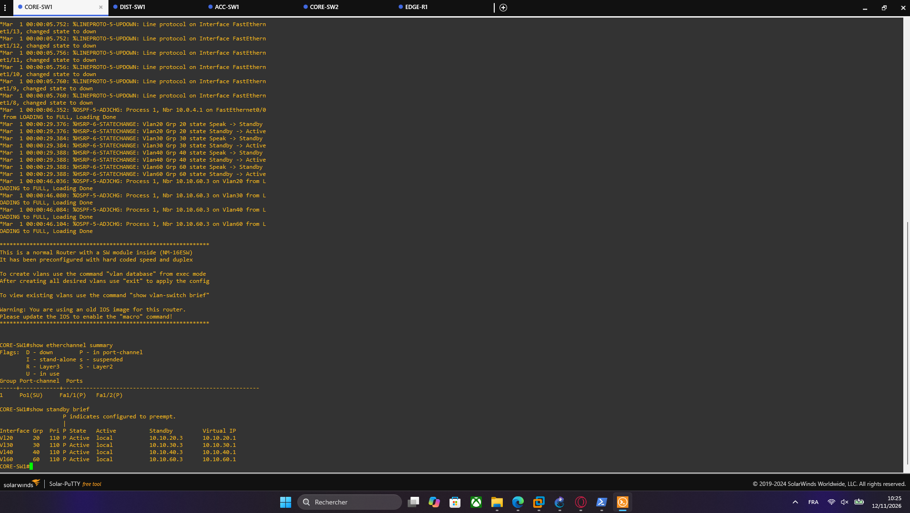

**Figure 2 — DIST-SW1 : Po2 en `(SU)` avec Fa1/1 et Fa1/3 en `(P)`**
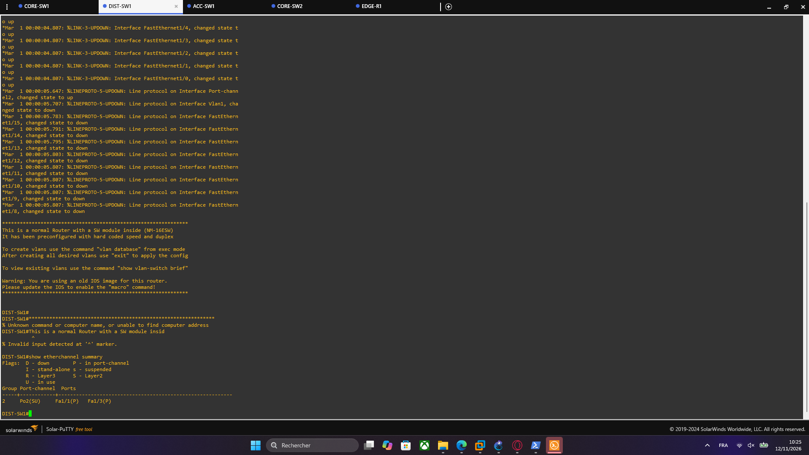

**Figure 3 — ACC-SW1 : Po2 en `(SU)` avec Fa1/0 et Fa1/3 en `(P)`**
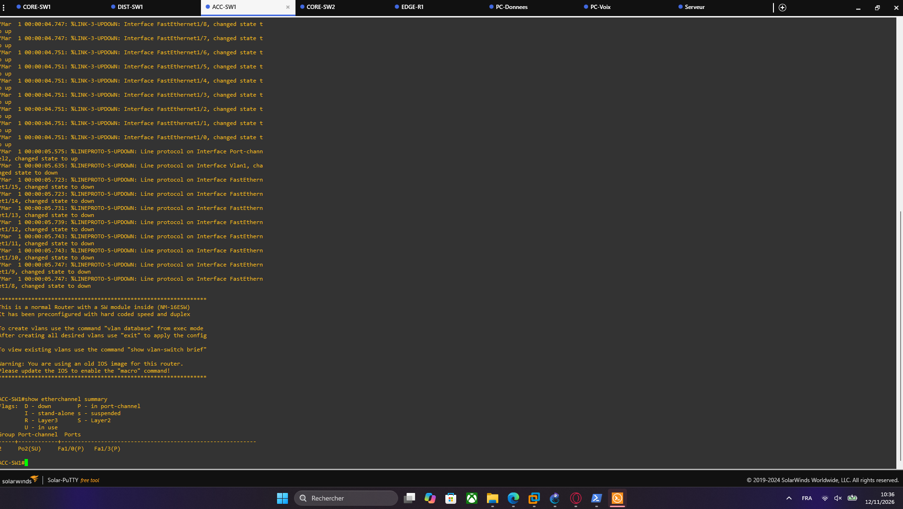

**Figure 4 — STP : CORE-SW1 est racine (priorité 4096)**
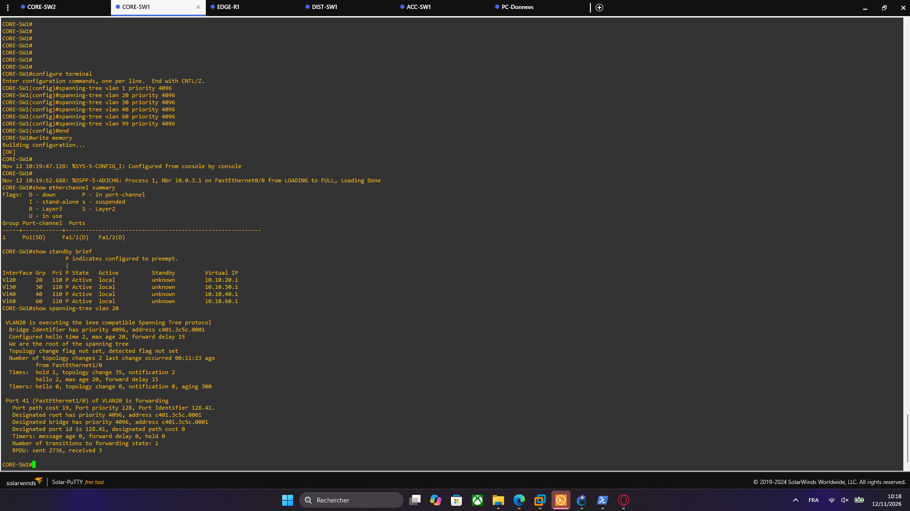

**Figure 5 — Ping PC-Donnees → Serveur (10.20.20.10), 5 réponses, TTL 61 : la chaîne complète fonctionne**
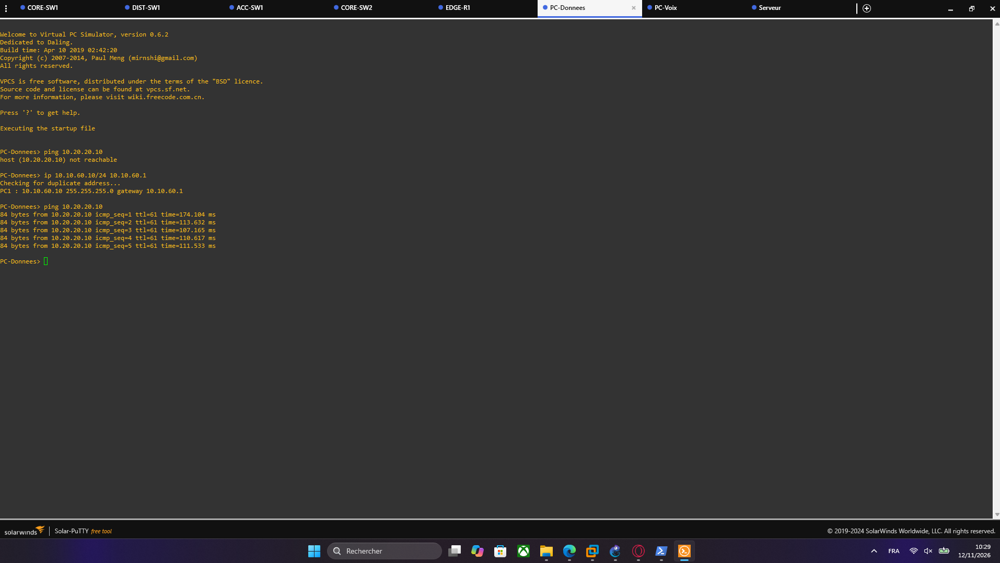

### 6.2 Preuve n°1 : coupure d'un lien de l'EtherChannel Po2

**Essai A — `shutdown` d'un seul côté (DIST-SW1 Fa1/1).** Un `ping -c 60` est lancé pendant la coupure.

**Figure 6 — `shutdown` de Fa1/1 : Fa1/1 passe en `(D)`, Po2 reste `(SU)` ; puis `no shutdown` : retour à `(P)`**
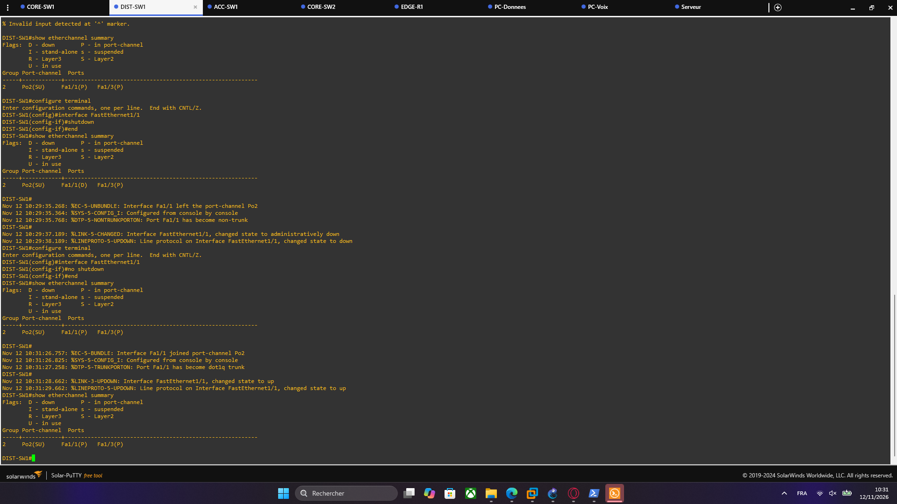

**Figure 7 — Ping PC-Donnees → Serveur pendant la coupure d'un seul côté**
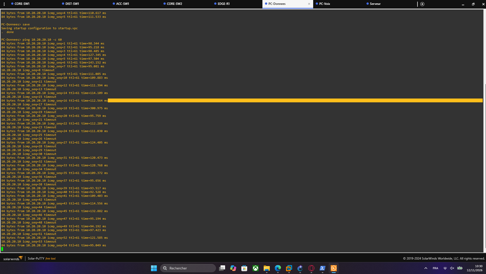

**Résultat :** sur les 54 premiers paquets, 23 sont perdus (≈ 43 %), et environ une réponse sur deux manque dès la coupure (≈ 49 % entre le paquet 8 et le paquet 54). La perte **ne se résorbe pas** tant que le lien reste coupé.

**Explication :** `shutdown` n'éteint que le port de DIST-SW1. Dans GNS3, le port d'ACC-SW1 en face reste actif. Avec un agrégat statique (`mode on`), ACC-SW1 n'a aucun protocole pour apprendre que son partenaire a retiré le membre : il continue de répartir la moitié du trafic sur le lien mort. Avec LACP, le membre serait retiré en quelques secondes. C'est la raison d'être de LACP, et la limite principale de cette maquette.

**Essai B — coupure franche (câble supprimé dans GNS3).** Les deux extrémités du lien tombent, comme lors d'une vraie coupure de câble.

**Figure 8 — Topologie après suppression d'un des deux câbles DIST-SW1 ↔ ACC-SW1 : le second lien reste en service**
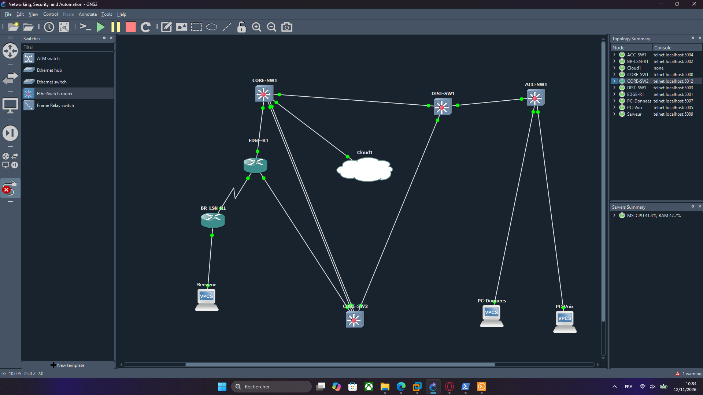

Après remise en place du câble et redémarrage des commutateurs, Po2 retrouve ses deux membres (Figure 3). _La perte de paquets pendant la coupure franche n'a pas été capturée (voir §7)._

### 6.3 Preuve n°2 : bascule de la passerelle redondante (HSRP) et d'OSPF

Test : `shutdown` de CORE-SW1 Fa0/0 (lien WAN 3a), puis `no shutdown`.

**Figure 9 — CORE-SW1 pendant la coupure : priorité tombée à 90 (110 − 20), état Standby pour les 4 groupes**
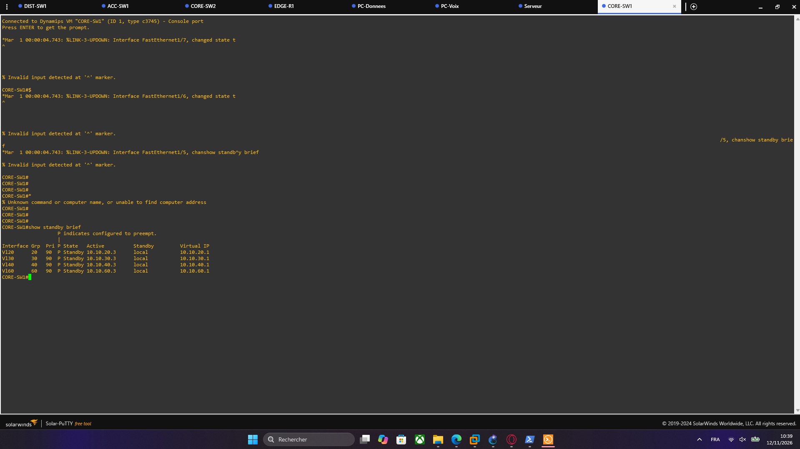

**Figure 10 — CORE-SW2 pendant la coupure : Active (`local`) pour les 4 groupes**
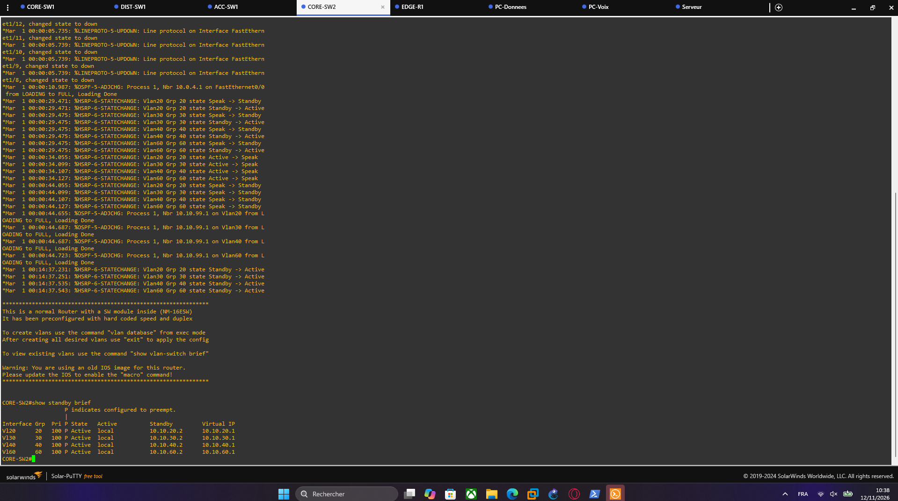

**Figure 11 — Retour du lien : priorité remontée à 110, CORE-SW1 repasse Active (journaux HSRP) et OSPF repasse à FULL**
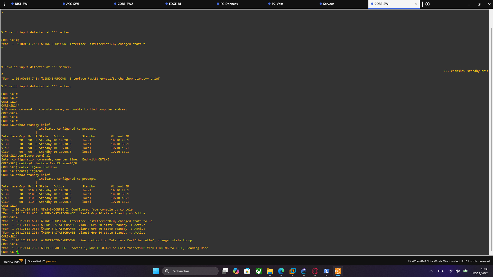

**Figure 12 — EDGE-R1 : voisins OSPF FULL avec CORE-SW2 (Fa0/0, 10.0.4.2) et CORE-SW1 (Fa1/0, 10.0.3.2)**
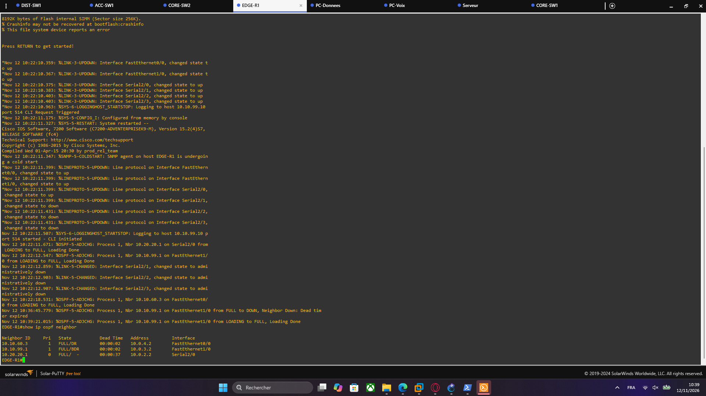

**Temps de convergence relevés dans les journaux :**

| Événement | Heure (journal) | Délai |
|---|---|---|
| Coupure Fa0/0 de CORE-SW1 | ≈ 10:36:42 (estimée) | — |
| CORE-SW2 passe Active | ≈ 10:36:45 | ≈ 3 s |
| EDGE-R1 : voisin CORE-SW1 « Dead timer expired » | 10:36:45 | ≈ 3 s (dead interval OSPF = 3 s) |
| `no shutdown` → CORE-SW1 repasse Active | 2 s après la commande | 2 s |
| OSPF CORE-SW1 ↔ EDGE-R1 à FULL | ≈ 5 s après la commande | ≈ 5 s |

L'heure de CORE-SW2 est déduite de son temps de fonctionnement (00:14:37) et de l'heure de son démarrage ; elle est donc à environ ± 1 s. **La perte de paquets pendant cette bascule n'a pas été mesurée par un ping** ; la convergence est établie par les journaux (§7).

---

## 7. Limites de la maquette et recommandations

| # | Limite | Conséquence | Recommandation |
|---|---|---|---|
| 1 | Pas de LACP ni PAgP sur NM-16ESW (agrégats statiques) | Un lien mort d'un seul côté n'est pas retiré : ≈ 49 % de perte constatée (§6.2) | LACP en production (`mode active`, `lacp rate fast`) |
| 2 | HSRP sur les **cœurs**, pas sur les distributions | Écart avec la consigne (« sur les distributions ou équivalent ») : DIST-SW1 est un commutateur L2 sans routage dans la maquette | En production, des distributions L3 (C9300) portent HSRP, les cœurs font le routage WAN |
| 3 | Une seule distribution et un seul accès dans la maquette | La redondance de distribution (2 distributions) n'est pas démontrée | Doubler DIST-SW1 en production |
| 4 | Liens FastEthernet 100 Mb/s | Les débits du §3.4 ne sont pas testables | Dimensionnement sur papier uniquement |
| 5 | PoE non simulable dans GNS3 | Budget PoE calculé, pas mesuré | Valider avec `show power inline` sur le matériel réel |
| 6 | Politique QoS de CDC-09 appliquée sur EDGE-R1 Fa1/0 seulement | Le chemin de secours (Fa0/0, lien 3b) n'a pas de QoS | Appliquer le même marquage sur Fa0/0 |
| 7 | Liens ajoutés à chaud non détectés par GNS3 | Ports en `D` jusqu'au redémarrage des nœuds | Redémarrer les commutateurs après tout ajout de câble |
| 8 | Perte de paquets non mesurée pendant la coupure franche (Po2) et pendant la bascule HSRP | Convergence documentée par les journaux, pas par un ping continu | Refaire avec `ping -c 60` et compter les timeouts |
| 9 | Configurations reconstituées | Risque d'écart avec l'état réel | Comparer avec `show running-config` |

---

## 8. Résumé pour le client (une page)

**Ce que nous avons fait.** Nous avons repensé le réseau du site de Genève en trois couches (accès, distribution, cœur) et supprimé les points uniques de défaillance. Le cœur est maintenant formé de deux commutateurs qui se secondent, et chaque couche est raccordée à la suivante par deux chemins.

**Ce que cela change pour vos équipes.**
- Si un câble ou un commutateur de cœur tombe, les postes et les téléphones gardent leur passerelle : la bascule prend environ 3 secondes sur notre maquette.
- Les postes n'ont rien à reconfigurer : l'adresse de passerelle reste la même.
- Le réseau est dimensionné pour vos 40 postes et 12 bornes Wi-Fi supplémentaires, avec de la marge.

**Dimensionnement (sur nos hypothèses de départ, à confirmer avec votre inventaire).**
- 4 commutateurs d'accès de 48 ports, dont 140 ports utilisés sur 192.
- Alimentation des téléphones et des bornes : 1 200 W nécessaires, 2 960 W disponibles.
- Liaisons de 10 Gb/s entre les couches : le trafic de pointe estimé en occupe 20 % à l'accès.

**Matériel recommandé.** Catalyst 9200L pour l'accès (le moins coûteux qui répond au besoin), Catalyst 9300 pour le cœur et la distribution (routage complet, liens 10 Gb/s, évolutif). Un châssis Catalyst 9400 ne se justifie qu'au-delà d'environ 450 ports.

**Ce que la maquette a montré.** La bascule de passerelle fonctionne. En revanche, nos commutateurs de test ne gèrent pas le protocole LACP : un lien défectueux d'un seul côté n'est pas détecté et fait perdre environ la moitié des paquets. Votre matériel réel gère LACP et corrige ce point ; nous recommandons de l'activer.

**Prochaines étapes.** Valider l'inventaire réel, commander le matériel, activer LACP, doubler la distribution, étendre la qualité de service au lien de secours, puis tester les pannes une fois le matériel installé.

---

## 9. Déclaration d'utilisation de l'IA générative

- **Outil utilisé :** Claude (Anthropic), assistant d'IA générative.
- **Usage :** accompagnement pas à pas de la réalisation (choix de conception, commandes EtherChannel, HSRP, STP, OSPF), aide au diagnostic (ports en `D` après ajout de liens à chaud, commandes refusées par l'IOS des NM-16ESW, perte de 50 % avec agrégat statique), recherche des données des fiches techniques Cisco, calculs du plan de capacité, génération du schéma et **rédaction de ce rapport**.
- **Travail de l'étudiant :** l'étudiant a câblé la maquette, exécuté toutes les commandes dans GNS3, provoqué les pannes de test et réalisé les captures d'écran.
- **Vérification :** les résultats des §6.1 à 6.3 sont ceux observés dans la maquette. Les effectifs du §3.1 sont des hypothèses, pas des données du client. Les chiffres matériels viennent des fiches Cisco citées ci-dessous.
- **Limites connues :** les fichiers de configuration sont des extraits reconstitués à partir des commandes appliquées ; la perte de paquets pendant la coupure franche et la bascule HSRP n'a pas été mesurée par ping (§7).

**Sources**
- [Cisco Catalyst 9200 Series Switches Data Sheet](https://www.cisco.com/c/en/us/products/collateral/switches/catalyst-9200-series-switches/nb-06-cat9200-ser-data-sheet-cte-en.html)
- [Cisco Catalyst 9300 Series Switches Data Sheet](https://www.cisco.com/c/zh_cn/products/collateral/switches/catalyst-9300-series-switches/nb-06-cat9300-ser-data-sheet-cte-en.html)
- [Cisco Catalyst 9400 Series Switch Data Sheet](https://www.cisco.com/c/en/us/products/collateral/switches/catalyst-9400-series-switches/nb-06-cat9400-ser-data-sheet-cte-en.html)
