# CDC-12 — Dépannage : incident multi-pannes sur le site de Sion

**Client :** NovaTrans Romandie SA · **Prestataire :** Satom IT & Learning Solutions
**Plateforme :** GNS3 (routeurs c7200 IOS 15.2, commutateurs simulés par c3745 + NM-16ESW, IOS 12.4)
**Ingénieur :** Rayan Zaghez · **Date :** 12 novembre 2026

> **Précision sur la méthode de test.** Le sujet prévoit que le formateur injecte trois pannes que l'étudiant ne connaît pas. Faute de pannes fournies, **l'étudiant a injecté lui-même trois pannes** des trois types demandés (port désactivé, VLAN absent d'un trunk, ACL qui bloque un port applicatif), sur la maquette du site de Genève qui sert de substitut au dépôt de Sion. Le diagnostic ci-dessous suit la démarche demandée, mais l'étudiant connaissait les causes avant de les « découvrir ». Les trois pannes sont aussi décrites plus bas dans la forme de l'énoncé.

---

## 1. Ticket d'incident

| Champ | Contenu |
|---|---|
| **Numéro** | INC-2026-1112-01 |
| **Ouvert par** | Rayan Zaghez (ingénieur réseau) |
| **Site** | Dépôt de Sion (maquette : réseau de Genève et Lausanne) |
| **Premier symptôme** | 11:02 (désactivation du port d'accès) |
| **Constat et ouverture** | 11:04 |
| **Symptômes rapportés** | Les terminaux de scan ne joignent plus le WMS. La téléphonie fonctionne partiellement. Des postes d'administration n'accèdent plus aux équipements. |
| **Symptômes observés** | PC-Donnees (VLAN 60, terminal de scan) : `host (10.10.60.1) not reachable`. PC-Voix (VLAN 40, téléphonie) : `host (10.10.40.1) not reachable`. Grafana : CORE-SW1, EDGE-R1 et BR-LSN-R1 en `DOWN` alors qu'ils répondent au ping. |
| **Portée** | Plusieurs VLAN et la supervision : plusieurs causes probables. |
| **Impact** | Le WMS (Serveur, Lausanne) est inaccessible depuis le VLAN 60 ; la voix ne sort plus du VLAN 40 ; la supervision est aveugle sur 3 équipements sur 5. |
| **Priorité** | Haute (activité de tri bloquée) |

**État de référence avant l'incident (11:01).** PC-Donnees et PC-Voix atteignent `10.20.20.10` (`ttl=61`) ; les 5 équipements sont `UP` dans Grafana.

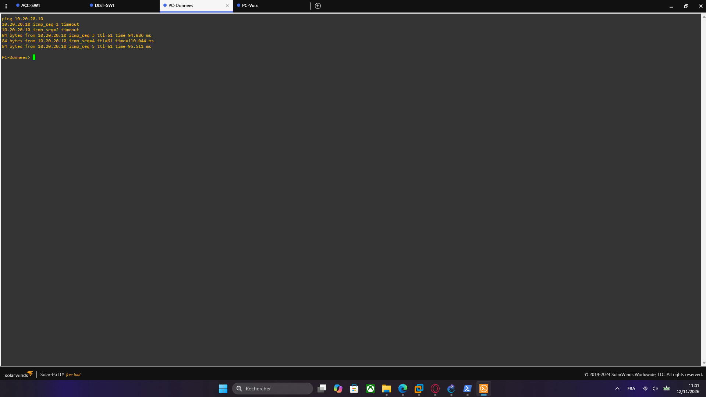
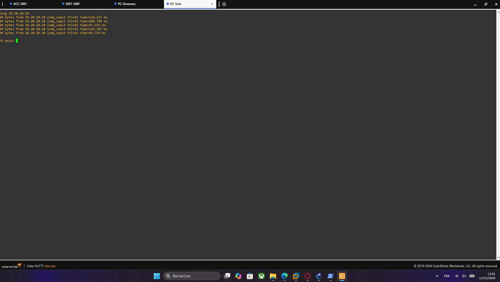
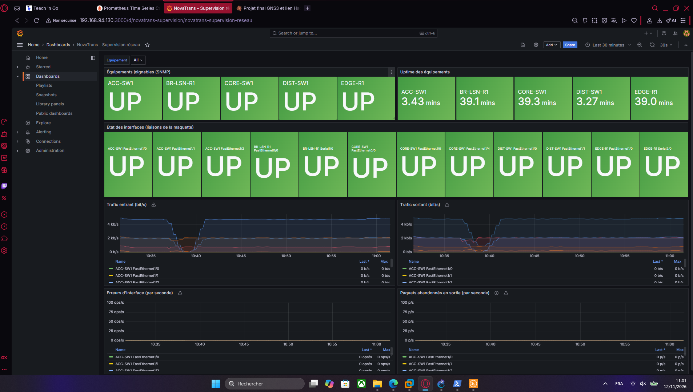

---

## 2. Méthode

**Approche retenue : de bas en haut (couche 1 vers couche 7).**
Le symptôme est large et touche des VLAN différents : on commence par vérifier que les liens sont montés et que les VLAN circulent (couches 1 et 2), puis le routage (couche 3), puis les services (couches 4 et plus). Cette approche évite de chercher un problème de service quand un câble ou un port est en cause.

**Outils :** `ping`, `trace`, `show interfaces`, `show interfaces trunk`, `show vlan-switch brief`, `show ip access-lists`, `show ip interface`, tableau de bord Grafana.

**Remarque sur les outils.** L'IOS des NM-16ESW n'a pas `show interfaces status` ; `show interfaces <port>` le remplace.

---

## 3. Journal de dépannage par couche

### Panne 1 — Port d'accès désactivé (couche 2, liaison)

| Étape | Contenu |
|---|---|
| **Symptôme** | PC-Donnees : `ping 10.20.20.10` et `trace` répondent `host (10.10.60.1) not reachable` : le poste n'atteint même pas sa passerelle. |
| **Couche OSI** | 2 (liaison de données : état du port d'accès) |
| **Hypothèse** | Le port d'ACC-SW1 qui sert PC-Donnees est arrêté. La couche 3 n'est pas en cause : la passerelle n'est pas joignable depuis le premier saut. |
| **Test** | ACC-SW1 : `show interfaces FastEthernet1/2`. |
| **Résultat** | `FastEthernet1/2 is administratively down, line protocol is down` (désactivé à 11:02:35). Grafana montre aussi ACC-SW1 FastEthernet1/2 en `DOWN`. |
| **Correction** | `interface FastEthernet1/2` puis `no shutdown` (11:08:44). |
| **Vérification** | `FastEthernet1/2 is up, line protocol is up`. PC-Donnees rejoint le WMS (voir §4). |

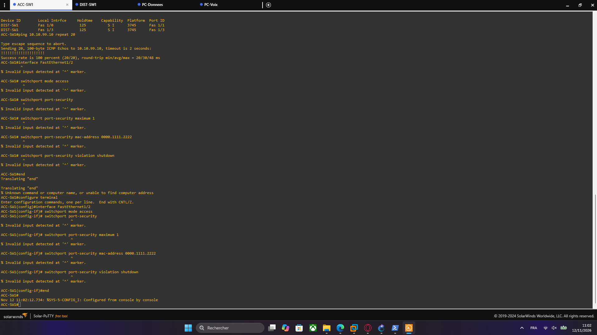
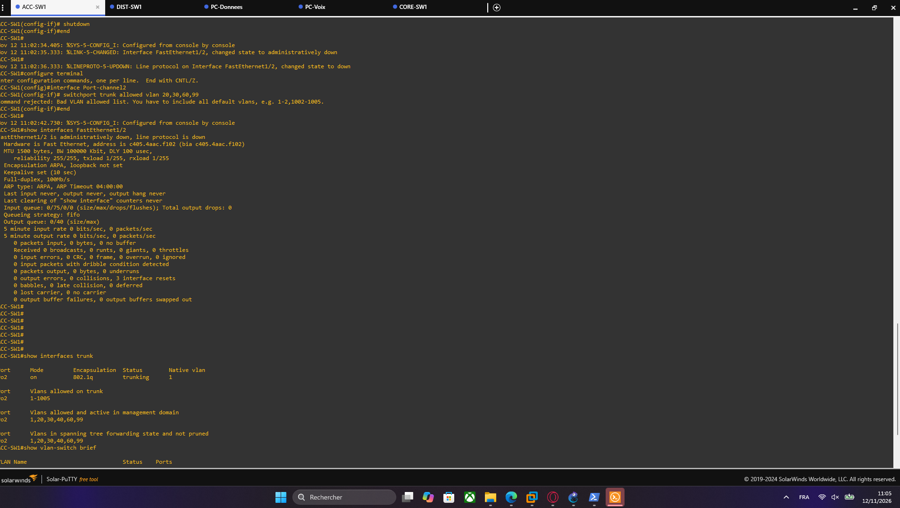
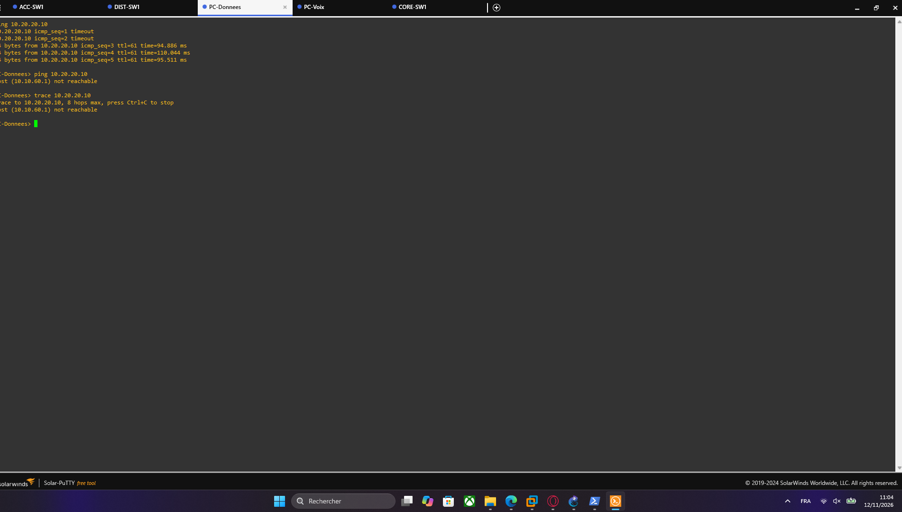
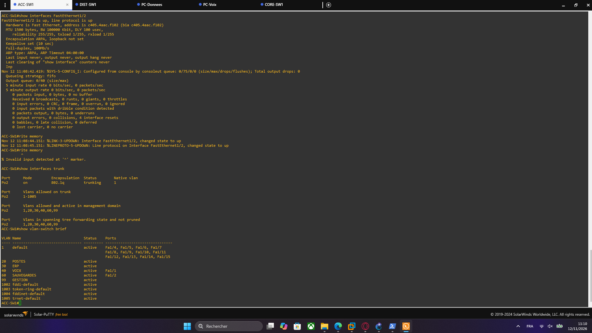

> L'objectif était un port en `err-disabled` (violation de sécurité). L'IOS des NM-16ESW refuse toutes les commandes `port-security` ; le port a donc été simplement désactivé. Le diagnostic est le même (port inactif côté accès) mais la cause racine d'un vrai `err-disabled` (violation d'adresse MAC, boucle) serait à chercher en plus.

### Panne 2 — VLAN absent d'un trunk (couche 2, VLAN / trunk)

| Étape | Contenu |
|---|---|
| **Symptôme** | PC-Voix (VLAN 40) : `ping 10.20.20.10` → `host (10.10.40.1) not reachable`. PC-Donnees (VLAN 60) n'est pas touché par ce symptôme. |
| **Couche OSI** | 2 (VLAN et trunk 802.1Q) |
| **Hypothèse** | Un seul VLAN est coupé et son port d'accès est actif : le VLAN 40 ne traverse plus le lien entre l'accès et la distribution. |
| **Test** | ACC-SW1 : `show interfaces trunk` et `show vlan-switch brief`. |
| **Résultat** | `Vlans allowed on trunk : 1-39,41-1005` (le 40 manque). `Vlans allowed and active in management domain` ne contient plus le 40 : `1,20,30,60,99`. Le VLAN 40 existe pourtant (`VOIX`, port Fa1/1). |
| **Correction** | `interface Port-channel2` puis `no switchport trunk allowed vlan` (11:12). |
| **Vérification** | `show interfaces trunk` revient à `1-1005` avec le VLAN 40 dans la liste des VLAN actifs. PC-Voix rejoint le WMS (voir §4). |

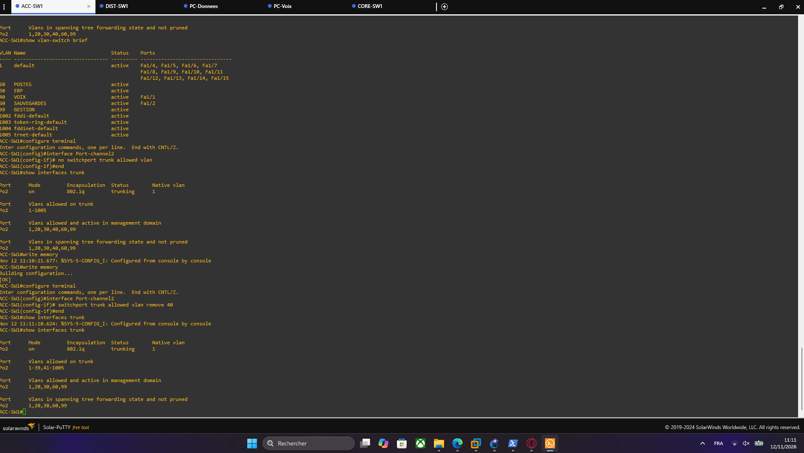
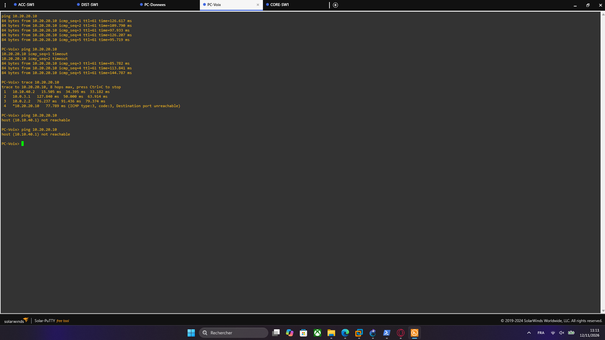
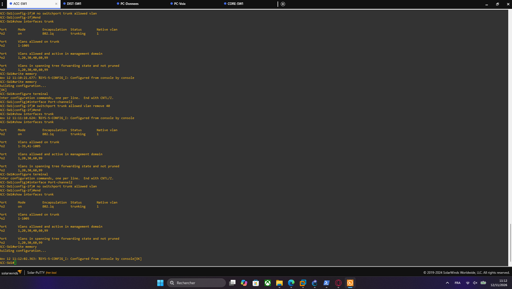

> Un premier essai (`switchport trunk allowed vlan 20,30,60,99`) a été refusé par l'IOS : `Bad VLAN allowed list. You have to include all default vlans`. La panne a été injectée avec `switchport trunk allowed vlan remove 40`.

### Panne 3 — ACL qui bloque un port applicatif (couche 4, transport)

| Étape | Contenu |
|---|---|
| **Symptôme** | Grafana : CORE-SW1, EDGE-R1 et BR-LSN-R1 passent en `DOWN`, alors que les équipements répondent au ping et que le trafic des utilisateurs continue de passer (PC-Voix atteint encore le WMS à 11:04). |
| **Couche OSI** | 4 (transport : blocage du port UDP 161, SNMP) |
| **Hypothèse** | Le routage et les liaisons sont sains (ping et `trace` répondent : 10.10.40.2 → 10.0.3.1 → 10.0.2.2 → 10.20.20.10). Seul le service SNMP est bloqué entre la VM de supervision et les équipements routés : un filtre sur le chemin. |
| **Test** | CORE-SW1 : `show ip access-lists` et `show ip interface Vlan99`. |
| **Résultat** | `ACL-MGMT-IN` : `10 deny udp host 10.10.99.10 any eq snmp (255 matches)`, `20 permit ip any any`. `Inbound access list is ACL-MGMT-IN` sur Vlan99. Les 255 correspondances confirment que l'ACL bloque du trafic réel. |
| **Correction** | `interface Vlan99`, `no ip access-group ACL-MGMT-IN in`, puis `no ip access-list extended ACL-MGMT-IN`. |
| **Vérification** | `show ip access-lists` ne liste plus que `ACL-SNMP-NMS` (4 800 correspondances, l'ACL d'origine de CDC-10) ; `show ip interface Vlan99` : `Inbound access list is not set`. Configuration enregistrée (`write memory` : `[OK]`). Grafana : les 5 équipements repassent `UP` (voir §4). |

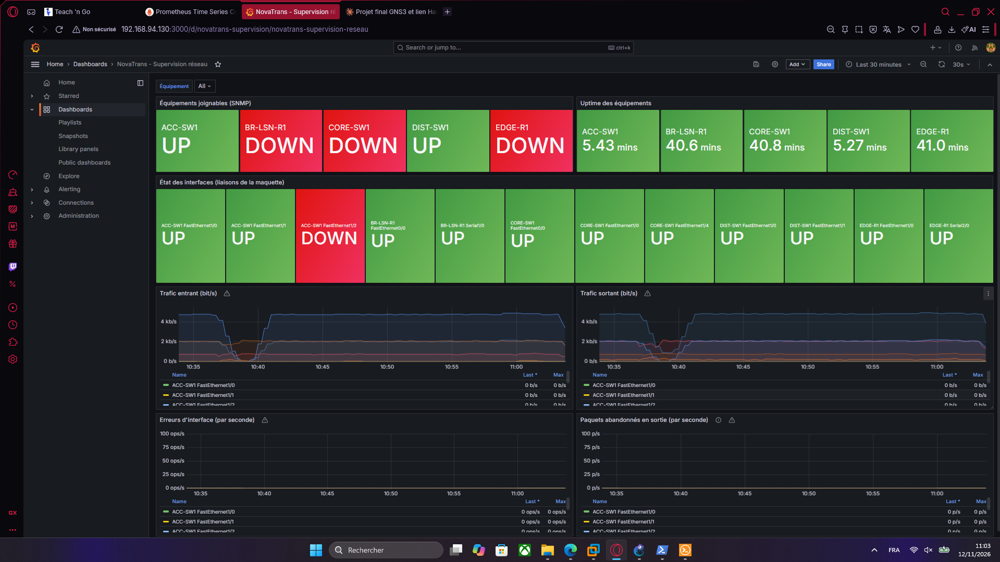
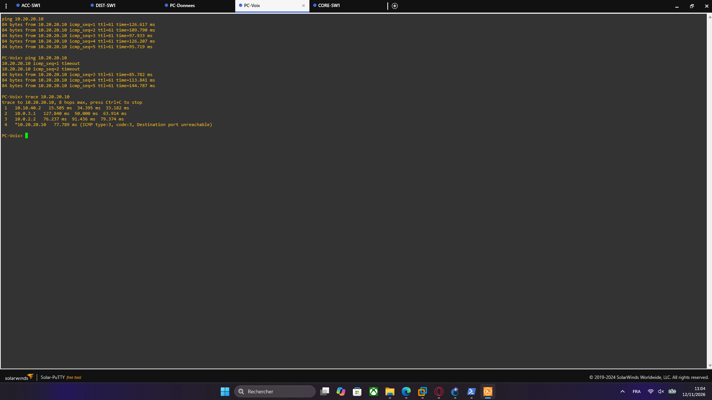
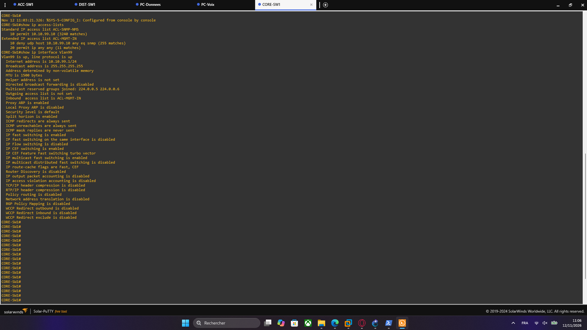
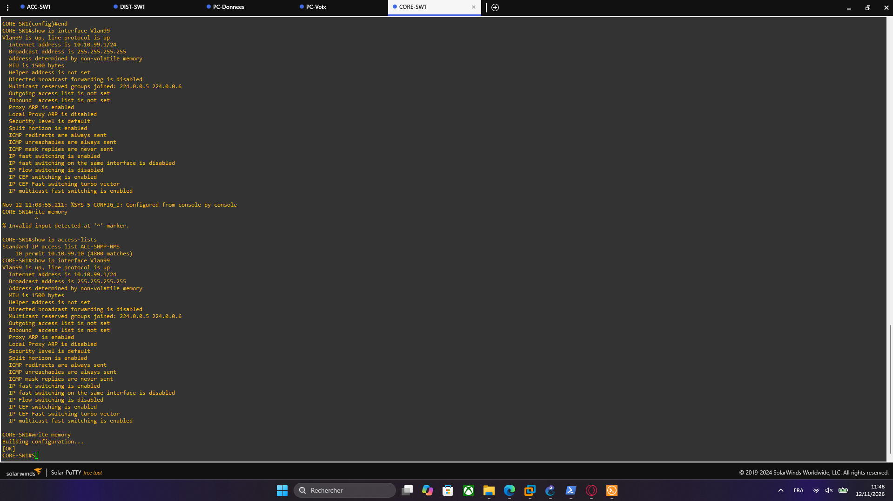

### Incident parasite (non injecté) — lien de l'EtherChannel absent

En préparant l'état de référence (10:50 à 10:59), un vrai problème est apparu : le ping ACC-SW1 → NMS-01 réussissait seulement à 20 %.

| Étape | Contenu |
|---|---|
| **Symptôme** | `ping 10.10.99.10 repeat 20` depuis ACC-SW1 : 20 % de réussite. DIST-SW1 → CORE-SW1 : 100 %. |
| **Couche OSI** | 1 et 2 (câblage, EtherChannel) |
| **Hypothèse** | Le tronçon ACC ↔ DIST perd des paquets : un membre de Po2 ne transporte rien. |
| **Test** | ACC-SW1 : `show cdp neighbors`. |
| **Résultat** | **Un seul voisin** (`Fas 1/0` ↔ DIST `Fas 1/1`). Aucun voisin sur `Fa1/3` : le second câble n'était pas relié, alors que `show etherchannel summary` affichait `Fa1/3(P)` des deux côtés. |
| **Correction** | Câble DIST Fa1/3 ↔ ACC Fa1/3 remis dans GNS3, redémarrage des deux commutateurs. |
| **Vérification** | `show cdp neighbors` : deux voisins. `ping` : 100 % (20/20). |

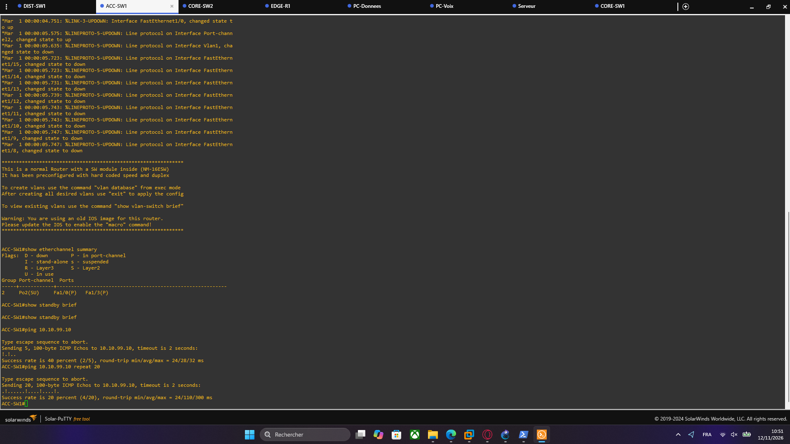
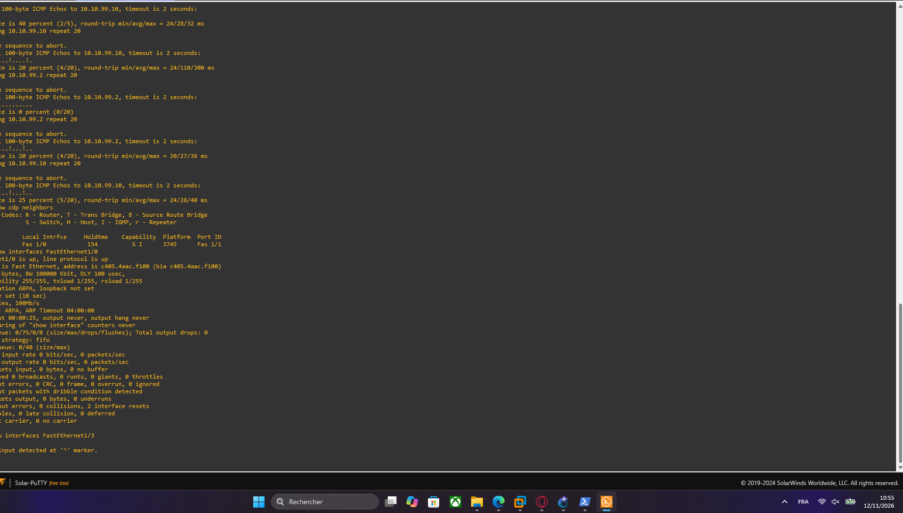
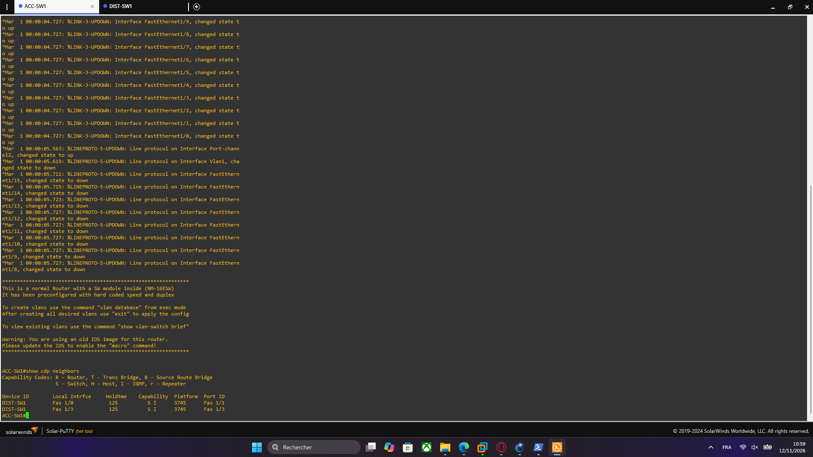
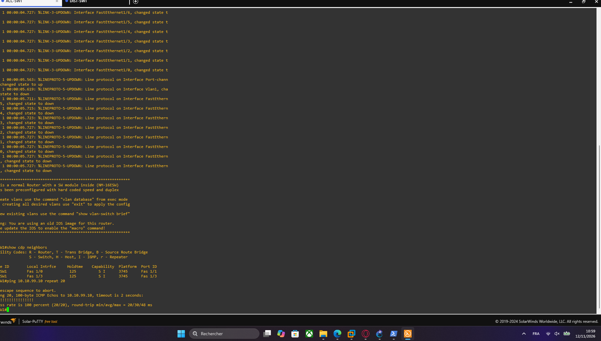

---

## 4. Vérification de bout en bout (avant / après)

| Test | Avant l'incident (11:01) | Pendant (11:04 à 11:11) | Après correction |
|---|---|---|---|
| PC-Donnees → Serveur `10.20.20.10` | réponses, `ttl=61` | `host (10.10.60.1) not reachable` | 5 réponses, `ttl=61` (11:47) |
| PC-Voix → Serveur `10.20.20.10` | réponses, `ttl=61` | `host (10.10.40.1) not reachable` (panne 2) | 3 réponses sur 5, `ttl=61` (11:47, les 2 premiers timeouts sont l'ARP) |
| Grafana, 5 équipements | 5 `UP` | 3 `DOWN` (panne 3), Fa1/2 `DOWN` (panne 1) | 5 `UP` (11:09, après correction des pannes 1 et 3) |
| `show interfaces trunk` (ACC-SW1) | `1-1005` | `1-39,41-1005` | `1-1005` |

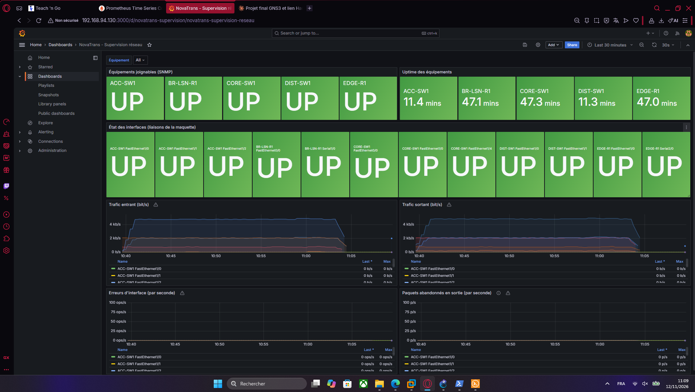
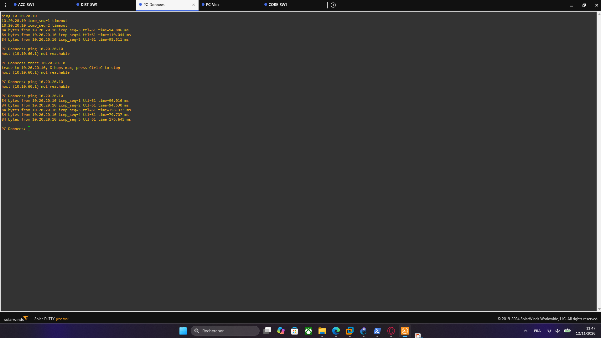
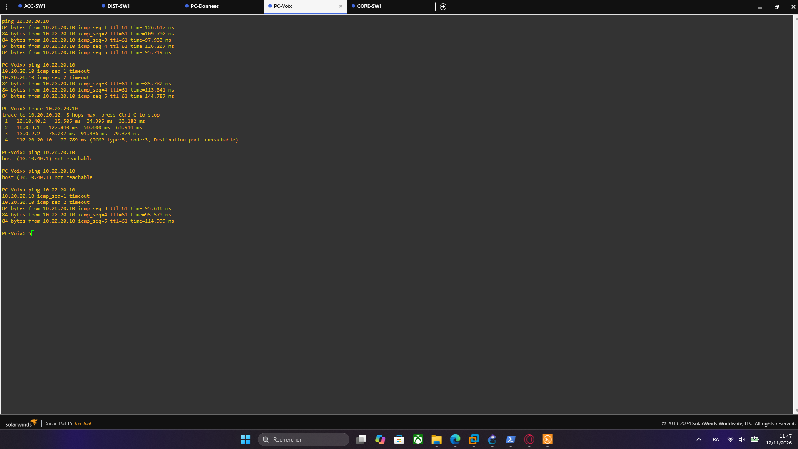

---

## 5. Documentation réseau mise à jour

### 5.1 Plan de VLAN

| VLAN | Nom | Usage | Réseau | Passerelle virtuelle (HSRP) | CORE-SW1 / CORE-SW2 |
|---|---|---|---|---|---|
| 1 | default | ports inutilisés | — | — | — |
| 20 | POSTES | postes | 10.10.20.0/24 | 10.10.20.1 | .2 / .3 |
| 30 | ERP | ERP, WMS | 10.10.30.0/24 | 10.10.30.1 | .2 / .3 |
| 40 | VOIX | téléphonie IP | 10.10.40.0/24 | 10.10.40.1 | .2 / .3 |
| 60 | SAUVEGARDES | données, sauvegardes | 10.10.60.0/24 | 10.10.60.1 | .2 / .3 |
| 99 | GESTION | supervision | 10.10.99.0/24 | — | CORE-SW1 .1, DIST-SW1 .2, ACC-SW1 .3, NMS-01 .10 |

### 5.2 Plan de ports

| Équipement | Port | Rôle | VLAN / réseau | Relié à |
|---|---|---|---|---|
| ACC-SW1 | Fa1/0, Fa1/3 | Po2 (EtherChannel, trunk 802.1Q, VLAN 1-1005) | tous | DIST-SW1 Fa1/1, Fa1/3 |
| ACC-SW1 | Fa1/1 | accès | 40 | PC-Voix |
| ACC-SW1 | Fa1/2 | accès | 60 | PC-Donnees |
| ACC-SW1 | Fa1/4 à Fa1/15 | inutilisés (VLAN 1) | 1 | — |
| DIST-SW1 | Fa1/1, Fa1/3 | Po2 (EtherChannel) | trunk | ACC-SW1 Fa1/0, Fa1/3 |
| DIST-SW1 | Fa1/0 | trunk | tous | CORE-SW1 Fa1/0 |
| DIST-SW1 | Fa1/5 | trunk (redondant) | tous | CORE-SW2 Fa1/5 |
| CORE-SW1 | Fa0/0 | routé | 10.0.3.2/30 | EDGE-R1 Fa1/0 |
| CORE-SW1 | Fa1/0 | trunk | tous | DIST-SW1 Fa1/0 |
| CORE-SW1 | Fa1/1, Fa1/2 | Po1 (EtherChannel) | trunk | CORE-SW2 Fa1/0, Fa1/1 |
| CORE-SW2 | Fa0/0 | routé | 10.0.4.2/30 | EDGE-R1 Fa0/0 |
| CORE-SW2 | Fa1/5 | trunk (redondant) | tous | DIST-SW1 Fa1/5 |
| EDGE-R1 | Serial2/0 | WAN | 10.0.2.0/30 | BR-LSN-R1 |

### 5.3 Changements issus de l'incident

- **ACL de gestion :** aucune ACL ne reste sur Vlan99 (la liste `ACL-MGMT-IN` est supprimée).
- **Trunk Po2 :** tous les VLAN autorisés (`1-1005`), comme avant l'incident.
- **Fa1/2 (ACC-SW1) :** actif, VLAN 60.
- **Plan de ports :** le lien ACC-SW1 Fa1/3 ↔ DIST-SW1 Fa1/3 est ajouté au plan : il était absent de la maquette sans que personne s'en aperçoive.

---

## 6. Rapport de post-incident

| | Cause racine | Action corrective | Mesure préventive |
|---|---|---|---|
| **Panne 1** | Un port d'accès (Fa1/2 d'ACC-SW1) est désactivé (arrêt administratif) : le poste ne peut plus joindre sa passerelle. | `no shutdown` sur le port. | Alerte Prometheus sur l'état des interfaces d'accès (déjà visible dans Grafana). Sur du matériel réel : `port-security` et `errdisable recovery` pour distinguer un arrêt volontaire d'une violation. |
| **Panne 2** | Le VLAN 40 est retiré de la liste des VLAN autorisés sur le trunk Po2 : la voix n'atteint plus la distribution. | `no switchport trunk allowed vlan` (retour à `1-1005`). | Comparer la configuration des trunks à la sauvegarde TFTP de la supervision après chaque changement. Documenter la liste des VLAN autorisés par trunk dans le plan de ports. |
| **Panne 3** | Une ACL entrante sur Vlan99 (`deny udp host 10.10.99.10 any eq snmp`) bloque SNMP depuis la VM de supervision vers les routeurs et vers CORE-SW1. | Suppression de l'ACL et de son application. | Ajouter `log` aux règles `deny`, tester le service (SNMP) et pas seulement le ping après tout changement d'ACL, et faire valider les ACL par une seconde personne. |
| **Incident parasite** | Le second lien de l'EtherChannel Po2 n'était pas raccordé alors que le commutateur l'affichait `(P)` : l'EtherChannel statique ne vérifie pas la présence du partenaire. | Câble rétabli et vérification par `show cdp neighbors`. | Utiliser LACP en production et contrôler le nombre de voisins CDP attendus après tout changement de câblage. |

**Enseignements.**
1. Un ping qui répond ne prouve pas qu'un service fonctionne (panne 3) : il faut tester le port applicatif.
2. Un équipement joignable peut afficher des ports « actifs » sans lien réel (incident parasite) : croiser l'état des ports avec CDP.
3. Dans la grille de supervision, trois symptômes différents venaient de trois couches différentes : le diagnostic de bas en haut a permis de les séparer.

---

## 7. Limites

- **Pannes auto-injectées** (voir l'avertissement en tête) : le diagnostic n'est pas aveugle.
- **Panne 1 : err-disabled non reproduit** (commandes `port-security` refusées par l'IOS) : remplacé par un arrêt administratif.
- **Panne 3 : le port applicatif bloqué est SNMP (UDP 161)**, et non le port d'un WMS : la maquette n'a pas de serveur applicatif TCP.
- **Dépôt de Sion :** il n'existe pas dans la maquette ; le site de Genève et Lausanne le remplace.

---

## 8. Résumé pour le client (une page)

**Ce qui s'est passé.** Au dépôt de Sion, les terminaux de scan ne joignaient plus le WMS, la téléphonie ne fonctionnait plus pour une partie des postes, et la supervision perdait de vue plusieurs équipements. Il ne s'agissait pas d'une panne unique : nous avons trouvé **trois causes indépendantes**, une par couche du réseau.

**Les trois causes et leur correction.**
1. **Un port d'accès éteint** : les terminaux de scan n'avaient plus de lien. Le port a été rallumé.
2. **Le VLAN de la téléphonie retiré d'une liaison** entre deux commutateurs : la voix ne passait plus. La liste des VLAN autorisés a été rétablie.
3. **Un filtre qui bloquait le service de supervision (SNMP)** : les équipements répondaient au ping mais étaient vus « en panne » par l'outil de supervision. Le filtre a été supprimé.

**Résultat.** Les trois pannes sont corrigées ; le réseau et la supervision sont revenus à l'état de référence (voir les tests avant / après).

**Ce que nous recommandons.**
- Tester le service (pas seulement le ping) après tout changement de filtre.
- Surveiller l'état des ports d'accès et alerter à l'arrêt.
- Contrôler la liste des VLAN de chaque liaison après chaque intervention.
- Utiliser LACP pour les liaisons agrégées : une liaison débranchée est alors détectée automatiquement.

**Durée.** Du premier symptôme (11:02) à la dernière correction (11:12) : environ 10 minutes sur la maquette.

---

## 9. Déclaration d'utilisation de l'IA générative

- **Outil utilisé :** Claude (Anthropic), assistant d'IA générative.
- **Usage :** conception des trois pannes à injecter, guidage pas à pas du diagnostic (commandes à lancer et lecture des sorties), aide à la correction, proposition du plan de ports et **rédaction de ce rapport** (ticket, journal, post-incident).
- **Travail de l'étudiant :** l'étudiant a tapé toutes les commandes, injecté les pannes, constaté les symptômes, corrigé et réalisé toutes les captures d'écran.
- **Point important :** les pannes ont été injectées par l'étudiant avec l'aide de l'IA, et non par le formateur ; le journal reflète donc un diagnostic où les causes étaient connues d'avance.
- **Vérification :** les sorties de commandes et horodatages viennent des captures. Les mesures préventives sont des recommandations, non testées dans la maquette.
