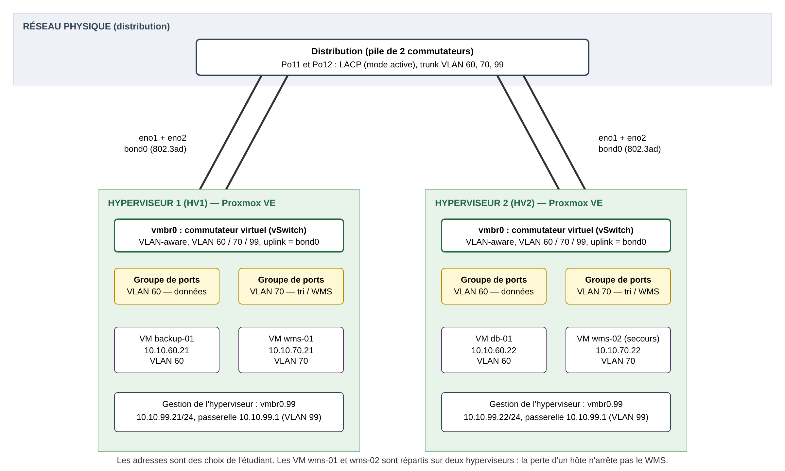
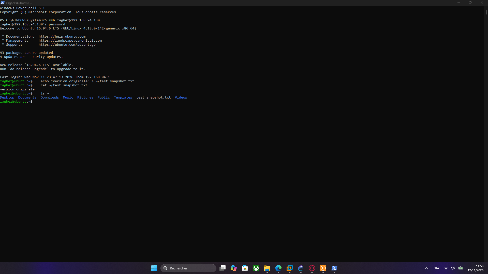
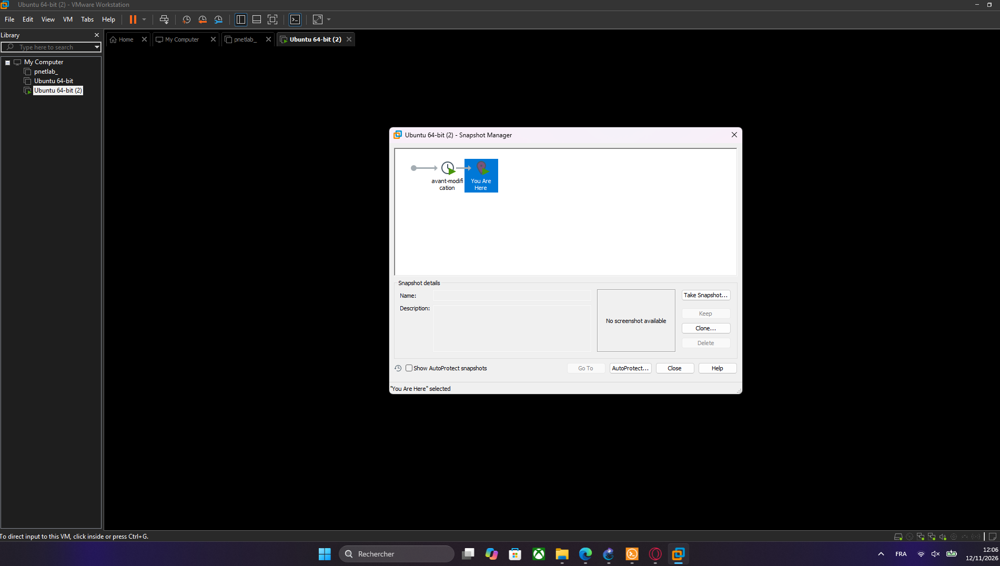
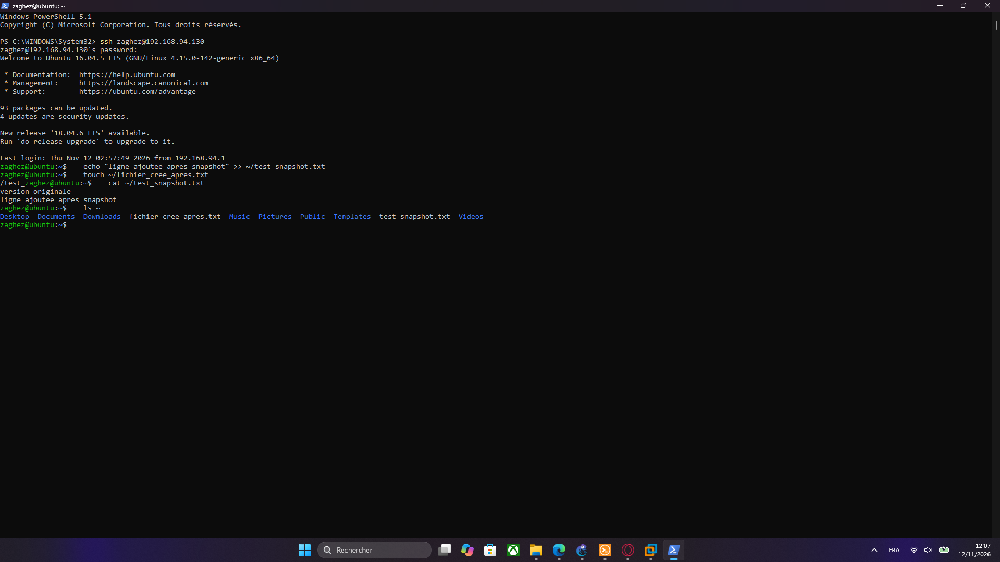
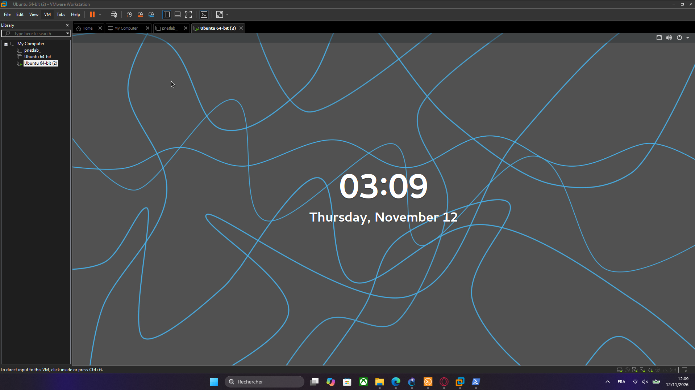
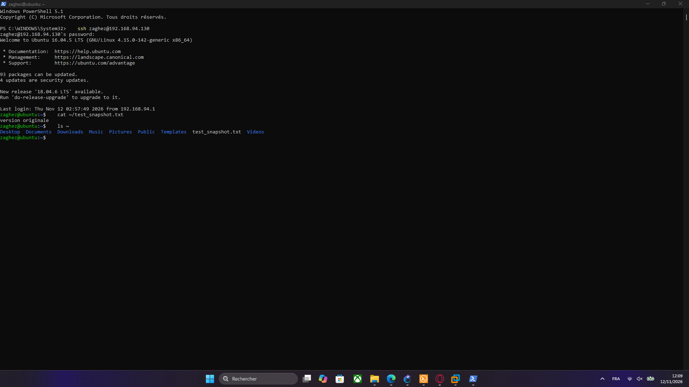
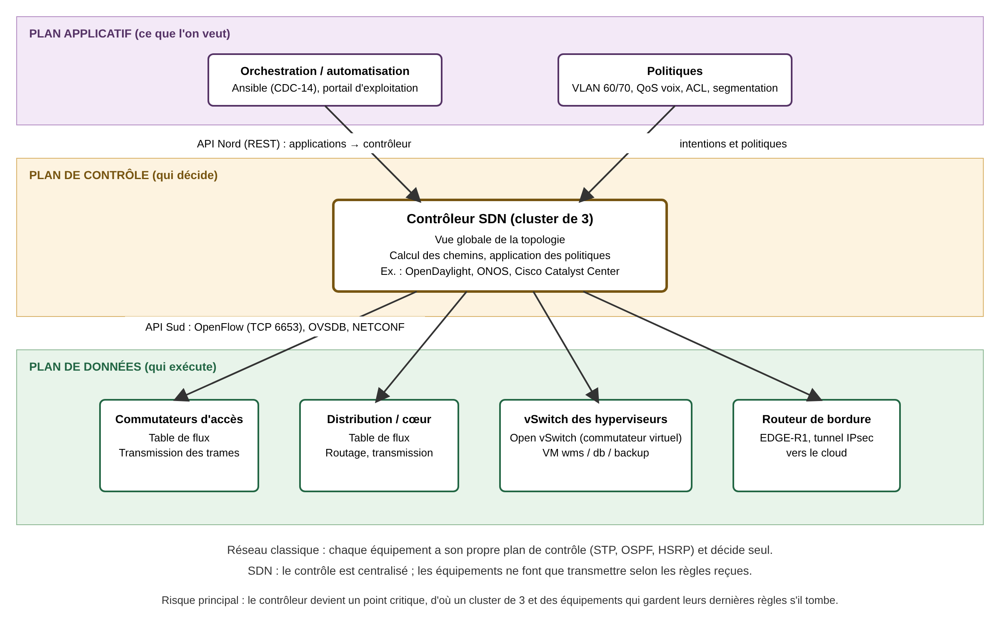

# CDC-13 — Virtualisation des serveurs et ouverture vers le cloud hybride

**Client :** NovaTrans Romandie SA · **Prestataire :** Satom IT & Learning Solutions
**Besoin couvert :** remplacer les serveurs physiques vieillissants de la plateforme de tri, préparer une sauvegarde vers le cloud, étudier une gestion SDN du datacenter
**Plateforme :** étude de conception (hyperviseurs, vSwitch, SDN, cloud) et preuve de snapshot sur une machine virtuelle Linux
**Ingénieur :** Rayan Zaghez · **Date :** 12 novembre 2026

> **Ce qui est réalisé et ce qui est conçu.** Seule la **preuve de snapshot** (§4) a été réalisée en vrai sur une machine virtuelle. Le plan de vSwitch (§3), le schéma SDN (§5) et la feuille de route cloud (§6) sont des **études de conception** : les configurations fournies n'ont pas été testées sur un hyperviseur ou un cloud réel. Les adresses IP et les noms de machines sont des choix de l'étudiant.

---

## 1. Demande du client et synthèse de la solution

Les serveurs de tri de NovaTrans tournent sur du matériel physique vieillissant. Le client veut les virtualiser sur deux hyperviseurs, préparer une sauvegarde vers le cloud et étudier une gestion SDN du datacenter.

**Solution proposée (résumé) :**

1. **Virtualiser** sur deux hôtes **Proxmox VE** (hyperviseur de type 1), avec les machines critiques réparties sur les deux hôtes.
2. **Connecter** les VM par un commutateur virtuel sensible aux VLAN (VLAN 60 données, VLAN 70 tri/WMS), avec deux cartes réseau agrégées en **LACP** par hôte.
3. **Protéger** les machines par des **snapshots** avant chaque modification (preuve au §4).
4. **Ouvrir** le site vers le cloud par un **tunnel IPsec**, en commençant par la **sauvegarde** (IaaS, stockage objet), puis un site de secours.
5. **Étudier le SDN** : séparer le plan de contrôle (contrôleur centralisé) du plan de données (équipements qui transmettent).

---

## 2. Comparatif des hyperviseurs

### 2.1 Type 1 et type 2

| Critère | Type 1 (« bare-metal ») | Type 2 (« hébergé ») |
|---|---|---|
| Fonctionnement | S'installe directement sur le matériel, sans système d'exploitation intermédiaire | S'installe comme une application dans un système d'exploitation (Windows, Linux) |
| Exemples | Proxmox VE (KVM), VMware ESXi, Microsoft Hyper-V | VMware Workstation, VirtualBox |
| Performances | Élevées (accès direct au matériel) | Plus faibles (couche du système hôte en plus) |
| Fiabilité | Élevée : peu de composants, conçu pour fonctionner en continu | Dépend du système hôte (mises à jour, redémarrages) |
| Fonctions de datacenter | Cluster, haute disponibilité, migration à chaud, agrégats réseau | Limitées ou absentes |
| Usage typique | Production, datacenter | Poste de travail, tests, laboratoire |

**Conclusion :** pour des serveurs de production qui doivent rester disponibles, un hyperviseur de **type 1** s'impose. Le type 2 convient à l'étudiant pour tester (c'est ce qui sert ici à la preuve de snapshot) mais pas à la plateforme de tri.

### 2.2 Candidats de type 1

| Critère | Proxmox VE 9.2 | VMware vSphere / ESXi | Microsoft Hyper-V |
|---|---|---|---|
| Base | KVM et conteneurs LXC, sur Debian 13 | Hyperviseur propriétaire | Intégré à Windows Server |
| Licence | Logiciel libre ; support payant à partir de 120 € par an et par processeur | Abonnement payant. **La version gratuite d'ESXi a été arrêtée le 13 février 2024** | Inclus avec les licences Windows Server |
| Cluster, haute disponibilité, migration à chaud | Oui (intégrés) | Oui (selon l'édition) | Oui (clustering Windows) |
| Agrégat de cartes (LACP) | Oui, `bond` 802.3ad sur Linux | **LACP seulement sur un commutateur distribué (vDS)** ; un commutateur standard ne gère que l'agrégat statique (IP hash) | Oui (équipe de cartes, mode LACP) |
| SDN intégré | Oui (zones, VLAN, VXLAN/EVPN, BGP, WireGuard) | Via produits complémentaires | Via produits complémentaires |
| Sauvegarde | Proxmox Backup Server (produit complémentaire) | Via produits tiers | Via produits tiers |
| Compétences à prévoir | Linux | VMware | Windows |

### 2.3 Recommandation : **Proxmox VE, sur 2 hôtes**

1. **Coût maîtrisé** : pas de licence par cœur, support optionnel à environ 120 € par an et par processeur.
2. **Agrégat LACP natif** pour les deux cartes réseau de chaque hôte ; chez VMware, LACP impose un commutateur distribué.
3. **Cluster, haute disponibilité et migration à chaud** intégrés, utiles pour répartir wms-01 et wms-02 sur les deux hôtes.
4. **SDN intégré** : le même outil sert à l'étude du §5.
5. **Pas de dépendance à la politique tarifaire d'un éditeur** (fin de la version gratuite d'ESXi en 2024).

**Point d'attention.** Un cluster de deux hôtes perd son quorum si l'un tombe : il faut prévoir un troisième vote (un petit serveur ou une VM « témoin » hors des deux hôtes). Si les équipes maîtrisent déjà VMware, vSphere reste une solution valable, avec un abonnement et un commutateur distribué pour le LACP.

---

## 3. Plan de vSwitch

**Principe :**
- Chaque hyperviseur a **2 cartes réseau** (`eno1`, `eno2`) agrégées en **`bond0` (802.3ad, LACP)**. Elles se branchent sur deux commutateurs différents de la pile de distribution : la panne d'une carte, d'un câble ou d'un commutateur n'interrompt pas les VM.
- Le **commutateur virtuel `vmbr0`** est sensible aux VLAN (« VLAN-aware ») : chaque VM reçoit une étiquette VLAN sur sa carte virtuelle, ce qui joue le rôle des **groupes de ports** : VLAN 60 pour les données, VLAN 70 pour le tri et le WMS.
- La **gestion** de l'hyperviseur passe par `vmbr0.99` dans le VLAN 99, comme tous les équipements du site.
- Les VM redondantes (`wms-01` et `wms-02`) sont sur **deux hôtes différents**.

| VLAN | Usage | Réseau | Passerelle |
|---|---|---|---|
| 60 | Données, sauvegardes (existant) | 10.10.60.0/24 | 10.10.60.1 (HSRP) |
| 70 | Tri / WMS (**nouveau**) | 10.10.70.0/24 | 10.10.70.1 (HSRP) |
| 99 | Gestion (existant) | 10.10.99.0/24 | 10.10.99.1 |

| Machine | Hôte | VLAN | Adresse |
|---|---|---|---|
| backup-01 | HV1 | 60 | 10.10.60.21 |
| wms-01 | HV1 | 70 | 10.10.70.21 |
| db-01 | HV2 | 60 | 10.10.60.22 |
| wms-02 (secours) | HV2 | 70 | 10.10.70.22 |
| HV1 / HV2 (gestion) | — | 99 | 10.10.99.21 / 10.10.99.22 |

**Configurations fournies (conception, non testées) :**
- `configs/HV1_proxmox_interfaces.txt` : agrégat LACP et `vmbr0`, côté hyperviseur.
- `configs/DIST_cote_hyperviseurs.txt` : `Port-channel` en LACP (`mode active`) et trunk VLAN 60, 70, 99, côté commutateurs.
- `configs/CORE_vlan70_hsrp.txt` : création du VLAN 70 sur les cœurs, même modèle que CDC-11.

**Lien avec CDC-11 :** la maquette GNS3 ne gère pas LACP (agrégats statiques, `mode on`). En production, LACP remplace ce mode : un lien débranché d'un seul côté est alors détecté (voir le test de CDC-11 qui a perdu environ la moitié des paquets).

---

## 4. Preuve de snapshot et de restauration

_Machine virtuelle Ubuntu 16.04 « Ubuntu 64-bit (2) » (VMware Workstation, rôle de VM de test Linux, adresse 192.168.94.130). Les commandes sont tapées en SSH depuis PowerShell. L'état est modifié après le snapshot, puis le snapshot est restauré._

**Étape 1 : état initial.** Création du fichier témoin `test_snapshot.txt` (contenu « version originale »). Le dossier personnel contient ce fichier et ne contient pas `fichier_cree_apres.txt`.

**Étape 2 : snapshot.** Snapshot `avant-modification` pris dans VMware (VM → Snapshot → Take Snapshot) et visible dans le Snapshot Manager.

**Étape 3 : modification après le snapshot.** Ajout d'une ligne dans `test_snapshot.txt` et création de `fichier_cree_apres.txt`. Le fichier contient maintenant deux lignes et le nouveau fichier apparaît.

**Étape 4 : restauration.** Retour au snapshot `avant-modification` dans VMware (Revert to Snapshot). La capture montre la VM après la restauration : elle est revenue à l'écran de verrouillage, état de la machine au moment du snapshot, et la connexion SSH précédente a été coupée.

**Étape 5 : vérification.** Nouvelle connexion SSH. Le fichier ne contient plus que « version originale » et `fichier_cree_apres.txt` a disparu : la machine est revenue exactement à l'état du snapshot.

| Élément | Avant le snapshot | Après modification | Après restauration |
|---|---|---|---|
| `test_snapshot.txt` | « version originale » | 2 lignes (ligne ajoutée) | « version originale » |
| `fichier_cree_apres.txt` | absent | présent | absent |

---

## 5. Plans de contrôle et de données (SDN)

| Plan | Rôle | Dans le réseau NovaTrans |
|---|---|---|
| **Plan applicatif** | Exprime ce que l'on veut obtenir | Ansible (CDC-14), politiques : VLAN 60 et 70, QoS de la voix, ACL |
| **Plan de contrôle** | **Décide** : connaît toute la topologie, calcule les chemins, applique les politiques | **Contrôleur SDN** (cluster de 3), par exemple OpenDaylight, ONOS ou Cisco Catalyst Center |
| **Plan de données** | **Exécute** : transmet les trames et paquets selon sa table de flux | Commutateurs d'accès, distribution et cœur, vSwitch (Open vSwitch) des hyperviseurs, routeur de bordure |

**Rôle d'OpenFlow et des API :**
- **API Sud (contrôleur → équipements) : OpenFlow** (TCP 6653) installe les règles de flux dans les équipements ; **OVSDB** configure les commutateurs virtuels ; **NETCONF** configure les équipements réseau classiques.
- **API Nord (applications → contrôleur) : REST.** Les outils d'automatisation demandent au contrôleur « crée le VLAN 70 » sans parler à chaque équipement.

**Différence avec le réseau actuel de NovaTrans :** aujourd'hui, chaque équipement a son propre plan de contrôle (STP, OSPF, HSRP) et décide seul. En SDN, le contrôle est centralisé : un changement s'écrit une fois et se déploie partout.

**Risque et réponse :** le contrôleur devient un point critique. On le met en cluster de 3 et les équipements conservent leurs dernières règles s'il tombe.

---

## 6. Feuille de route cloud (2 pages)

### 6.1 Objectif et choix de départ

**Objectif :** ouvrir NovaTrans vers le cloud hybride sans exposer les données, en commençant par ce qui apporte le plus de valeur avec le moins de risque : la **sauvegarde hors site**.

**Modèle de service retenu :**
- **IaaS (stockage objet et, plus tard, machines de secours)** pour la sauvegarde et la reprise après sinistre : NovaTrans garde la maîtrise de ses machines et de ses clés de chiffrement.
- **SaaS** seulement pour des outils standards qui ne portent pas les données de tri (étape ultérieure, à évaluer).

**Hypothèses de l'étudiant (à valider avec le client) :** perte de données acceptable de 24 heures (sauvegarde quotidienne), reprise du service sous 8 heures.

### 6.2 Étapes

| Phase | Contenu | Livrable | Prérequis |
|---|---|---|---|
| 0. Cadrage | Classer les données (tri, personnel, financier), choisir une région **suisse**, vérifier la conformité à la loi fédérale sur la protection des données (nLPD) | Registre des données et décision de région | — |
| 1. Sauvegarde | Envoyer les sauvegardes des VM vers un stockage objet cloud, **chiffrées avant l'envoi**, avec conservation 3-2-1 | Première sauvegarde complète restaurée en test | Phase 0 |
| 2. Tunnel sécurisé | Tunnel **IPsec site à site** entre EDGE-R1 et la passerelle cloud (`configs/EDGE-R1_tunnel_cloud_IPsec.txt`) | Tunnel monté, routes annoncées, journalisé | Phase 0 |
| 3. Reprise (DR) | Réplication des VM critiques (`wms`, `db`) vers des machines IaaS en veille | Test de bascule documenté | Phases 1 et 2 |
| 4. Évaluation SaaS | Étudier la messagerie ou la supervision en SaaS | Note de décision | Phase 3 |

### 6.3 Points de sécurité de la migration

| Domaine | Mesure |
|---|---|
| **Tunnel** | IPsec avec IKEv2, chiffrement AES-256, intégrité SHA-256, groupe Diffie-Hellman 14 ou supérieur, secret ou certificat long et unique, rotation des clés |
| **Données** | Chiffrement **côté NovaTrans** avant l'envoi : le fournisseur ne voit jamais les données en clair. Clés conservées sur site |
| **Accès** | Droits minimaux par compte, authentification multifacteur pour tous les comptes d'administration cloud |
| **Intégrité** | Stockage **non modifiable** (verrouillage objet) pour résister à un rançongiciel, et test de restauration chaque mois |
| **Réseau** | Aucune machine cloud exposée à Internet sans nécessité ; filtrage par groupes de sécurité ; le trafic de sauvegarde passe par le tunnel |
| **Conformité** | Région suisse, contrat de traitement des données, droit d'audit |
| **Supervision** | Journaux du tunnel et du cloud envoyés au Syslog central (CDC-10) ; alerte si la sauvegarde ne se termine pas |
| **Sortie** | Plan de sortie : données récupérables dans un format standard, pour ne pas dépendre d'un seul fournisseur |

### 6.4 Risques

| Risque | Réponse |
|---|---|
| Liaison WAN trop lente pour la première sauvegarde (2 Mb/s sur la maquette) | Première copie complète par envoi de disque ou sur une plage horaire de nuit, puis sauvegardes incrémentales |
| Fuite de clés | Clés hors du cloud, accès journalisé |
| Dépendance à un fournisseur | Formats standards et plan de sortie |
| Coût imprévu du stockage et des sorties de données | Suivi mensuel, alertes de budget (les coûts n'ont pas été estimés ici) |

---

## 7. Limites

- **Études de conception :** les configurations Proxmox, des commutateurs de distribution et du tunnel IPsec n'ont pas été testées (pas d'hyperviseur ni de cloud dans la maquette).
- **Dimensionnement non chiffré :** les ressources des VM (processeur, mémoire, disque) et les coûts du cloud ne sont pas estimés.
- **Hypothèses de l'étudiant :** adresses, noms de machines, objectifs de reprise (24 h / 8 h).
- **Snapshot :** réalisé sur une VM de laboratoire, pas sur les serveurs de tri.
- **Sources :** les caractéristiques de Proxmox VE 9.2, la fin de la version gratuite d'ESXi et les contraintes LACP de VMware viennent des sources citées ci-dessous, consultées le 12 novembre 2026.

---

## 8. Résumé pour le client (une page)

**Le besoin.** Vos serveurs de tri tournent sur un matériel qui vieillit. Une panne matérielle peut arrêter la plateforme.

**Ce que nous proposons.**
- **Virtualiser** les serveurs sur deux machines **Proxmox VE**, en répartissant les serveurs critiques sur les deux : si une machine tombe, l'autre prend le relais.
- **Doubler les liaisons réseau** de chaque machine (LACP) et séparer le trafic dans deux réseaux : un pour les données (VLAN 60), un pour la plateforme de tri (VLAN 70).
- **Prendre un snapshot avant chaque modification** : en cas d'erreur, on revient à l'état précédent en quelques minutes. Nous l'avons démontré sur une machine de test.
- **Sauvegarder vers le cloud** (région suisse), chiffré avant l'envoi, par un tunnel sécurisé, avec un test de restauration chaque mois.
- **Étudier une gestion centralisée du réseau (SDN)** pour déployer les changements une fois pour tous les équipements, dans une étape ultérieure.

**Pourquoi Proxmox.** Pas de licence par cœur (support optionnel à environ 120 € par an et par processeur), fonctions de haute disponibilité et d'agrégation de liaisons incluses. La version gratuite de VMware ESXi n'existe plus depuis février 2024.

**À savoir.** Un cluster de deux machines demande un troisième « témoin » pour décider qui reste actif. La sauvegarde cloud commence par la copie des données (une première copie complète peut être longue sur votre liaison actuelle).

**Étapes proposées.** Valider le classement des données et la région cloud ; installer les deux hôtes ; migrer les serveurs un par un avec un snapshot avant chaque migration ; mettre en place le tunnel et la sauvegarde ; tester la restauration.

---

## 9. Déclaration d'utilisation de l'IA générative

- **Outil utilisé :** Claude (Anthropic), assistant d'IA générative.
- **Usage :** recherche des caractéristiques d'hyperviseurs et de leurs contraintes (LACP, licences), conception du plan de vSwitch, du schéma SDN et de la feuille de route cloud, rédaction des configurations d'exemple et **rédaction de ce rapport**.
- **Travail de l'étudiant :** l'étudiant a réalisé la preuve de snapshot sur sa machine virtuelle (commandes, snapshot, restauration, captures) et a relu les choix de conception.
- **Vérification :** les chiffres sur les produits viennent des sources citées. Les configurations ne sont **pas testées** et les adresses, durées de reprise et noms de machines sont des hypothèses de l'étudiant.
- **Limites connues :** aucune estimation de coûts ; aucun test sur hyperviseur ou cloud réel.

**Sources**
- [Proxmox Virtual Environment 9.2 : annonce](https://www.proxmox.com/en/news/press-releases/proxmox-virtual-environment-9-2)
- [Broadcom met fin à la version gratuite d'ESXi (ServeTheHome)](https://www.servethehome.com/broadcom-vmware-ends-free-vmware-vsphere-hypervisor-closing-an-era/)
- [Link Aggregation Requirements for ESXi (Broadcom KB)](https://knowledge.broadcom.com/external/article/324555/host-requirements-for-link-aggregation-e.html)
