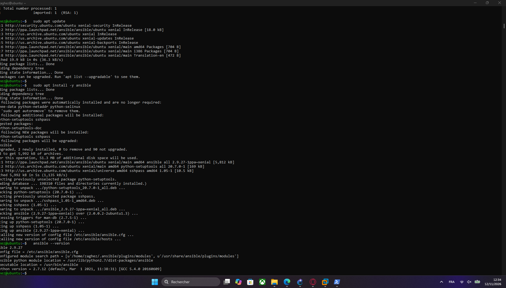
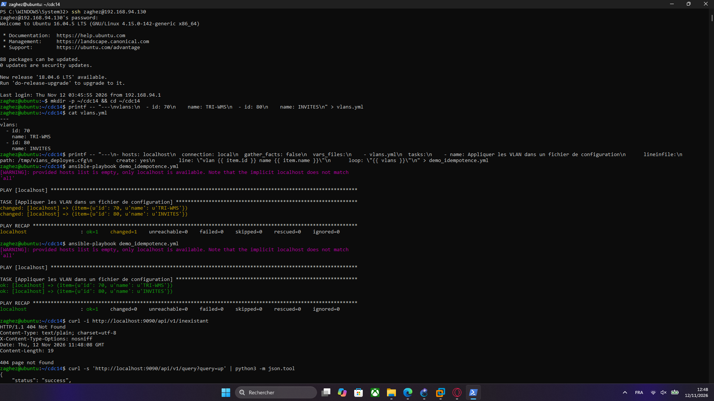
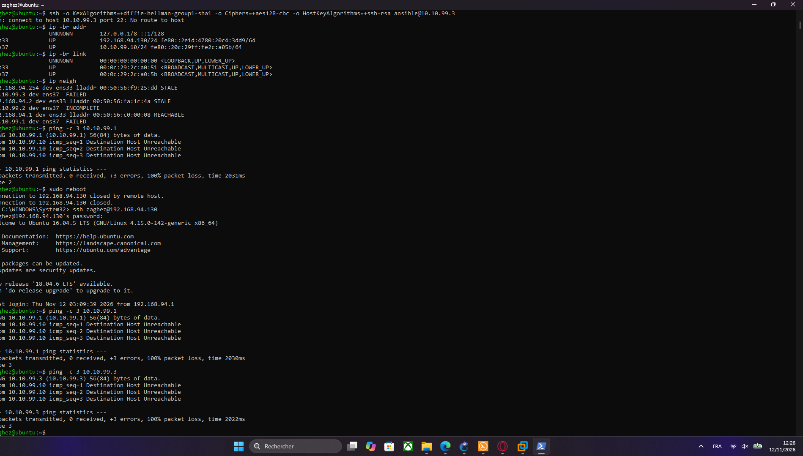
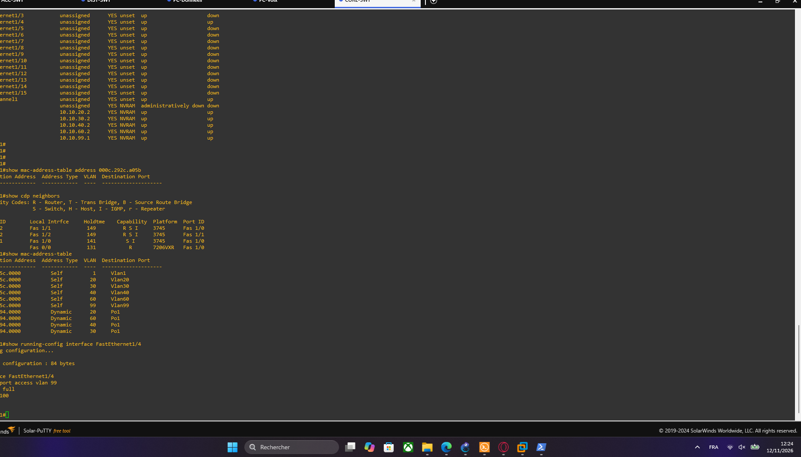
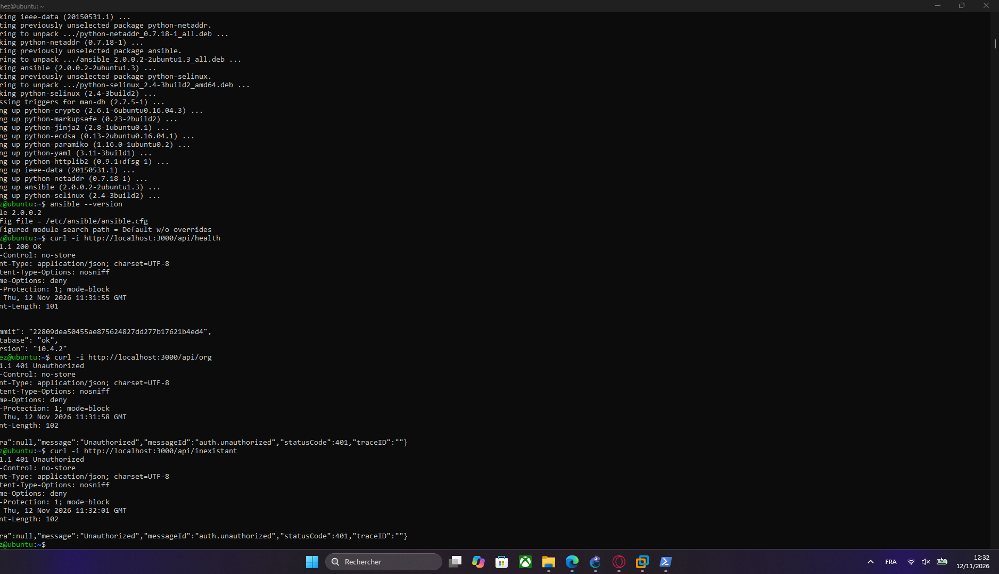

# CDC-14 — Automatisation du déploiement de VLAN et lecture d'API

**Client :** NovaTrans Romandie SA · **Prestataire :** Satom IT & Learning Solutions
**Besoin couvert :** une procédure automatisée pour ajouter des VLAN sur les commutateurs d'accès (les interventions manuelles provoquent des erreurs), et un accès en lecture seule aux données du réseau par API pour le tableau de bord du client
**Ingénieur :** Rayan Zaghez · **Date :** 12 novembre 2026

> **Ce qui est réalisé et ce qui ne l'est pas.** Sont **réalisés et prouvés** (captures) : l'installation d'Ansible 2.9.27, le fichier YAML des VLAN, la démonstration d'idempotence d'un playbook exécuté deux fois (`changed=1` puis `changed=0`) et les requêtes API (codes 200, 401, 404). Le **playbook qui configure réellement les commutateurs** (`deploy_vlans.yml`) est **écrit mais n'a pas pu être exécuté** : la liaison entre la VM Ansible (NMS-01) et la maquette GNS3 est tombée en fin de journée (§4.3). Il est donc livré **non testé sur les commutateurs**. De plus, la maquette ne compte **qu'un commutateur d'accès (ACC-SW1)** et non quatre.

---

## 1. Demande du client et synthèse

NovaTrans veut cesser d'ajouter les VLAN à la main sur chaque commutateur. La solution proposée :

1. **Décrire** les VLAN à déployer dans **un seul fichier YAML** (identifiant, nom, ports).
2. **Appliquer** ce fichier avec **Ansible**, sans agent, par SSH : le playbook lit l'état réel du commutateur et n'applique que ce qui manque (**idempotence**).
3. **Lire** les données du réseau par une **API REST** en lecture seule (méthode GET, réponse JSON), pour alimenter le tableau de bord.
4. **Choisir** l'outil de gestion de configuration après comparaison d'Ansible, Chef, Puppet et Terraform.

---

## 2. Données : le fichier YAML des VLAN

Un seul fichier décrit l'intention. Pour ajouter un VLAN, on ajoute un bloc, sans toucher au playbook.

```yaml
---
vlans:
  - id: 70
    name: TRI-WMS
    ports:
      - FastEthernet1/5
  - id: 80
    name: INVITES
    ports:
      - FastEthernet1/6
```

_Fichier complet : `ansible/vlans.yml`. (La version de démonstration exécutée sur la VM, au §4.1, ne contient que l'identifiant et le nom.)_

L'inventaire (`ansible/inventory.ini`) liste ACC-SW1 (10.10.99.3, groupe `acces`) et DIST-SW1 (10.10.99.2, groupe `distribution`). **Il ne contient aucun mot de passe** : il est demandé à l'exécution (`--ask-pass`). Il fixe aussi les options SSH nécessaires à l'IOS 12.4, trop ancien pour les réglages par défaut du client SSH de la VM.

---

## 3. Le playbook

Le playbook de déploiement est `ansible/deploy_vlans.yml`. Principe, étape par étape :

| Étape | Tâche | Rôle |
|---|---|---|
| 1 | `ios_command : show vlan-switch brief` | Lire l'**état réel** des VLAN du commutateur |
| 2 | `ios_config` (parents `vlan <id>`, ligne `name <nom>`) avec `when:` | Créer **uniquement** les VLAN absents ou mal nommés |
| 3 | `ios_config` (parents `interface <port>`) | Affecter les ports en mode accès |
| 4 | `ios_command : show vlan-switch brief` + `debug` | **Vérifier** et afficher le résultat |
| Handler | `write memory` | Sauvegarder seulement si une modification a eu lieu |

**Choix technique justifié :** le module `ios_vlan` n'a pas été utilisé, car il lit `show vlan brief`, commande qui n'existe pas sur le module NM-16ESW (c'est `show vlan-switch brief`). Sur ce module, les VLAN sont aussi stockés dans `vlan.dat` et non dans la configuration courante : on lit donc l'état réel et on conditionne la création avec `when:`.

**Prérequis SSH sur les commutateurs :** à l'état initial, ACC-SW1 affichait `SSH Disabled - version 1.99` (pas de clés RSA). Les commandes à appliquer (domaine, clés RSA, utilisateur local, `transport input ssh`) sont dans `configs/ACC-SW1_ssh_prerequis.txt` (mot de passe masqué `********`). L'image `C3745-ADVIPSERVICESK9` (IOS 12.4(4)T1) contient le chiffrement nécessaire à SSH.



_La version initiale d'Ansible (2.0.0.2, dépôt Ubuntu 16.04) n'a pas les modules Cisco ; elle a été remplacée par la 2.9.27 du dépôt officiel Ansible._

---

## 4. Exécution et idempotence

### 4.1 Preuve d'idempotence (réalisée sur la VM)

Le playbook `ansible/demo_idempotence.yml` applique **le même fichier YAML** à un fichier local (`/tmp/vlans_deployes.cfg`) avec le module `lineinfile`. Il a été exécuté **deux fois de suite** :

| Exécution | Résultat | Signification |
|---|---|---|
| 1ʳᵉ | `changed: ... TRI-WMS`, `changed: ... INVITES` · récapitulatif `changed=1` | Les lignes n'existaient pas : elles sont créées |
| 2ᵉ | `ok: ... TRI-WMS`, `ok: ... INVITES` · récapitulatif `changed=0` | Rien à faire : **aucun changement** |

(`changed=1` compte la tâche, qui a modifié ses deux éléments.)



**Limite :** cette preuve porte sur le **mécanisme** (le même fichier de données, exécuté deux fois sans effet à la seconde). Elle ne prouve pas le résultat sur un commutateur, qui n'a pas pu être testé (§4.3).

### 4.2 Ce qui devait être exécuté sur les commutateurs

```
ansible-playbook deploy_vlans.yml --ask-pass     # 1ʳᵉ exécution : changed > 0
ansible-playbook deploy_vlans.yml --ask-pass     # 2ᵉ exécution  : changed=0
```

**Non exécuté** — voir ci-dessous.

### 4.3 Incident : liaison entre la VM Ansible et la maquette coupée

Après la restauration du snapshot de la VM (CDC-13), la VM NMS-01 ne joint plus aucun équipement du VLAN 99.

| Constat | Preuve |
|---|---|
| Ping vers 10.10.99.1, .2 et .3 : 100 % de perte, `Destination Host Unreachable` émis par la VM elle-même |  |
| Voisins ARP en `FAILED` / `INCOMPLETE` sur `ens37` | même capture (`ip neigh`) |
| La table MAC de CORE-SW1 ne contient pas la MAC de la VM (`000c.292c.a05b`) ; `Vlan99` est up/up et Fa1/4 est en `access vlan 99`, up/up |  |

**Vérifications faites (sans résultat) :** carte réseau 2 de la VM connectée en Host-only (VMnet1), VMnet1 en Host-only avec adaptateur hôte connecté, adaptateur Windows activé, nœud Cloud GNS3 sur « VMware Network Adapter VMnet1 », redémarrage de la VM. **Cause racine non identifiée.** Les commutateurs eux-mêmes fonctionnent : le problème est entre la VM et GNS3.

**Conséquence :** impossible d'ouvrir une session SSH depuis la VM vers ACC-SW1 et donc d'exécuter `deploy_vlans.yml`. Il est livré tel quel, **non testé sur les commutateurs**.

---

## 5. API REST et réponse JSON

L'API utilisée est celle de la **supervision déjà en place chez NovaTrans** (CDC-10) : Grafana (port 3000) et Prometheus (port 9090), sur la VM NMS-01, en GET, **en lecture seule**.

| Requête (GET) | Code | Interprétation |
|---|---|---|
| `curl -i http://localhost:3000/api/health` | **200 OK** | La requête est valide et le service répond ; la réponse est du JSON |
| `curl -i http://localhost:3000/api/org` | **401 Unauthorized** | La ressource existe mais exige une authentification ; aucun identifiant n'a été fourni |
| `curl -i http://localhost:9090/api/v1/inexistant` | **404 Not Found** | Le chemin n'existe pas |

Grafana vérifie l'authentification avant de chercher la page : une requête vers un chemin inexistant sous `/api/` renvoie donc 401 et non 404. Le 404 est pris sur Prometheus, qui n'a pas d'authentification.



**Extrait de la réponse JSON (`/api/health`, code 200) :**

```json
{
  "commit": "22809dea50455ae875624827dd277b17621b4ed4",
  "database": "ok",
  "version": "10.4.2"
}
```

_Lecture : `database: ok` indique que la base de Grafana répond ; `version` indique la version du service (10.4.2)._ Le code 404 de Prometheus est visible sur la capture du §4.1.

**Sécurité :** aucun jeton ni mot de passe n'apparaît dans ce rapport. Pour le tableau de bord, on créera un jeton d'accès **en lecture seule** (rôle « Viewer »), à stocker hors des fichiers livrés.

---

## 6. Comparatif des outils de gestion de configuration

| Critère | **Ansible** | Chef | Puppet | Terraform |
|---|---|---|---|---|
| Fonctionnement | **Sans agent** : se connecte par SSH (ou API) et pousse la configuration | Agent installé sur chaque machine, qui tire sa configuration d'un serveur | Agent installé sur chaque machine, qui tire sa configuration d'un serveur | Outil de **provisionnement** : décrit et crée l'infrastructure ; garde un fichier d'état |
| Langage | YAML (playbooks) | Ruby (« recettes ») | Langage déclaratif propre (manifestes) | HCL |
| Équipements réseau (CLI) | **Très bien couvert** (modules Cisco IOS, etc.), sans rien installer sur le commutateur | Peu adapté : un agent ne s'installe pas sur un commutateur classique | Peu adapté, pour la même raison | Faible pour la configuration CLI d'équipements classiques ; fort pour le cloud |
| Prise en main | Rapide, lisible | Plus longue (Ruby) | Plus longue (langage dédié) | Moyenne |
| Idempotence | Oui (selon les modules) | Oui | Oui | Oui (par comparaison avec l'état) |
| Usage typique | Configuration de serveurs et d'équipements réseau, automatisation d'opérations | Parc de serveurs gérés en continu | Parc de serveurs gérés en continu | Création d'infrastructure cloud |

**Choix retenu : Ansible.** Les commutateurs de NovaTrans ne peuvent pas recevoir d'agent ; Ansible les pilote par SSH sans rien y installer. Les playbooks YAML restent lisibles par une équipe réseau, et les mêmes fichiers servent de documentation. **Terraform** reste pertinent pour la partie cloud (CDC-13) et ne remplace pas Ansible sur les commutateurs. _(Le comparatif est une synthèse de l'étudiant et de l'IA à partir de connaissances générales sur ces outils, non adossée à des sources citées ; à vérifier avant un usage contractuel.)_

---

## 7. Limites

- **Déploiement sur commutateurs non testé** : liaison VM ↔ GNS3 coupée (§4.3). Le playbook `deploy_vlans.yml` n'a jamais été exécuté sur un équipement ; il peut contenir des erreurs à corriger au premier essai (syntaxe `ios_config` sur NM-16ESW, options SSH).
- **Un seul commutateur d'accès** dans la maquette (ACC-SW1), au lieu des quatre du besoin client.
- **Idempotence prouvée sur un fichier local**, pas sur un commutateur.
- **SSH sur les commutateurs :** les commandes sont fournies ; leur application n'est pas confirmée.
- **Comparatif d'outils** sans sources citées.

---

## 8. Résumé pour le client (une page)

**Le besoin.** Vos équipes ajoutent les VLAN à la main sur chaque commutateur, et les erreurs sont fréquentes. Vous voulez aussi lire les données du réseau depuis votre tableau de bord.

**Ce que nous proposons.**
- **Un seul fichier** décrit les VLAN à créer (numéro, nom, ports). Pour en ajouter un, on ajoute quelques lignes.
- **Ansible** applique ce fichier sur les commutateurs, sans rien y installer. Si on relance la procédure, **elle ne change rien** quand tout est déjà en place : on peut donc la relancer sans risque. Nous l'avons démontré sur la machine de supervision.
- **Une API en lecture seule** donne les informations du réseau à votre tableau de bord, avec un jeton qui ne permet que de lire.

**Ce qui est démontré, et ce qui reste à faire.** La logique de la procédure et l'API fonctionnent. **Le déploiement sur vos commutateurs n'a pas encore été testé** : la liaison entre notre poste d'automatisation et la maquette est tombée avant ce test. Il faudra le faire avant toute mise en production, d'abord sur un commutateur, puis sur les autres.

**Pourquoi Ansible.** Il se connecte aux commutateurs sans installer de logiciel dessus, ce que les autres outils étudiés (Chef, Puppet) exigent. Terraform reste utile pour le cloud.

**Étapes proposées.** Rétablir la liaison du poste d'automatisation, activer SSH sur les commutateurs, tester le playbook sur ACC-SW1, vérifier que la seconde exécution ne change rien, puis étendre aux autres commutateurs d'accès.

---

## 9. Déclaration d'utilisation de l'IA générative

- **Outil utilisé :** Claude (Anthropic), assistant d'IA générative.
- **Usage :** conception du fichier YAML, de l'inventaire et des playbooks, choix techniques (non-utilisation de `ios_vlan`, lecture de `show vlan-switch brief`), aide au diagnostic de la coupure réseau, rédaction du comparatif d'outils et **rédaction de ce rapport**.
- **Travail de l'étudiant :** installation d'Ansible, saisie des commandes sur la VM, exécution du playbook de démonstration (deux fois), requêtes API, captures et vérifications réseau.
- **Vérification :** les résultats présentés comme obtenus sont ceux des captures. Le playbook de déploiement sur commutateurs, la configuration SSH des commutateurs et le comparatif d'outils **ne sont pas vérifiés**.
- **Limites connues :** voir le §7.
